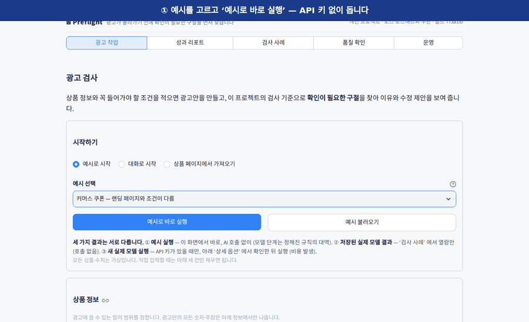
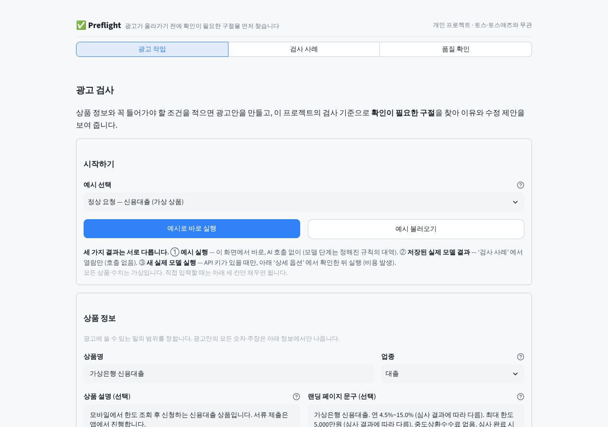
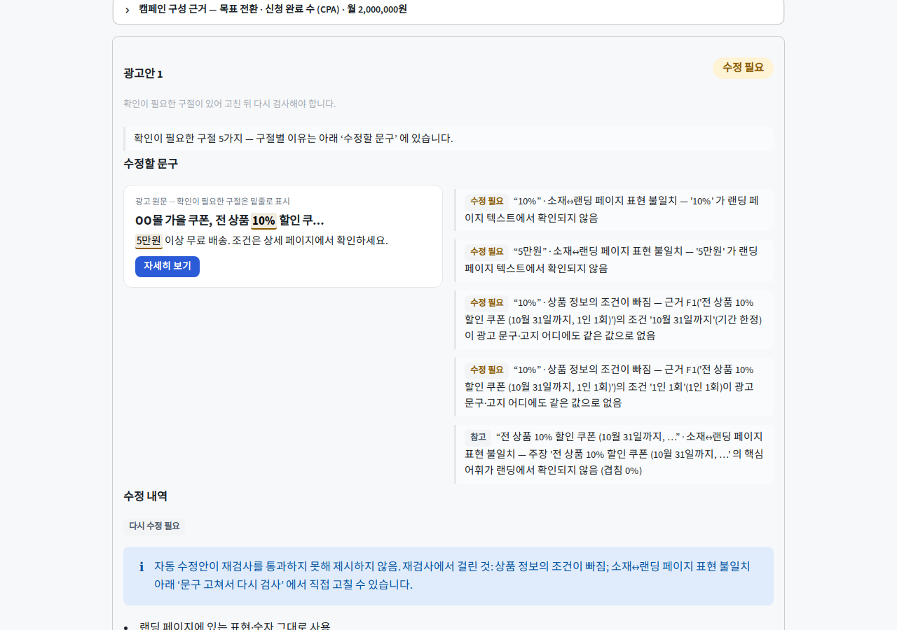
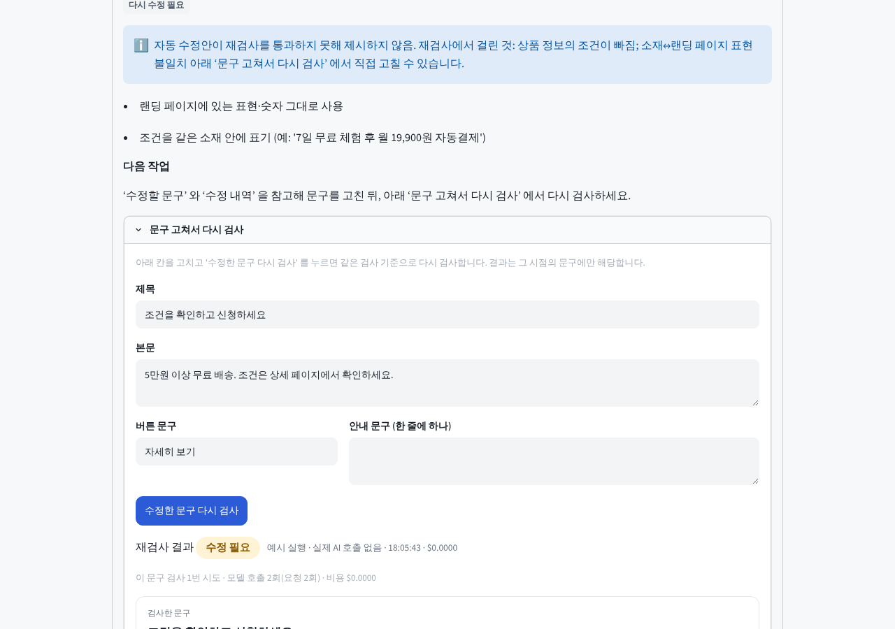
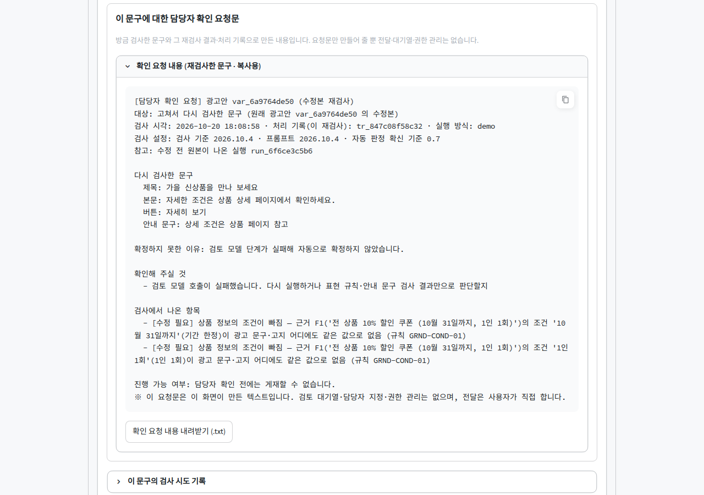
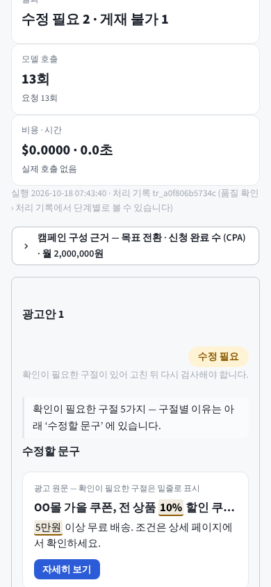
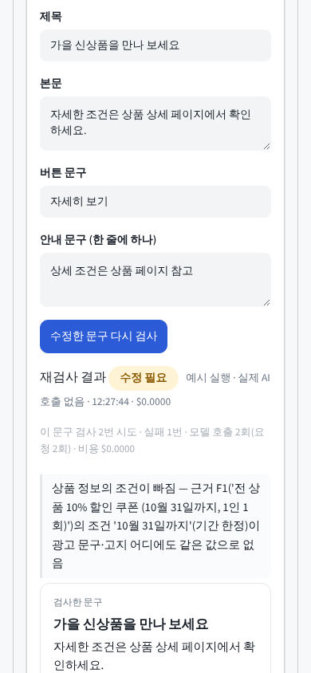
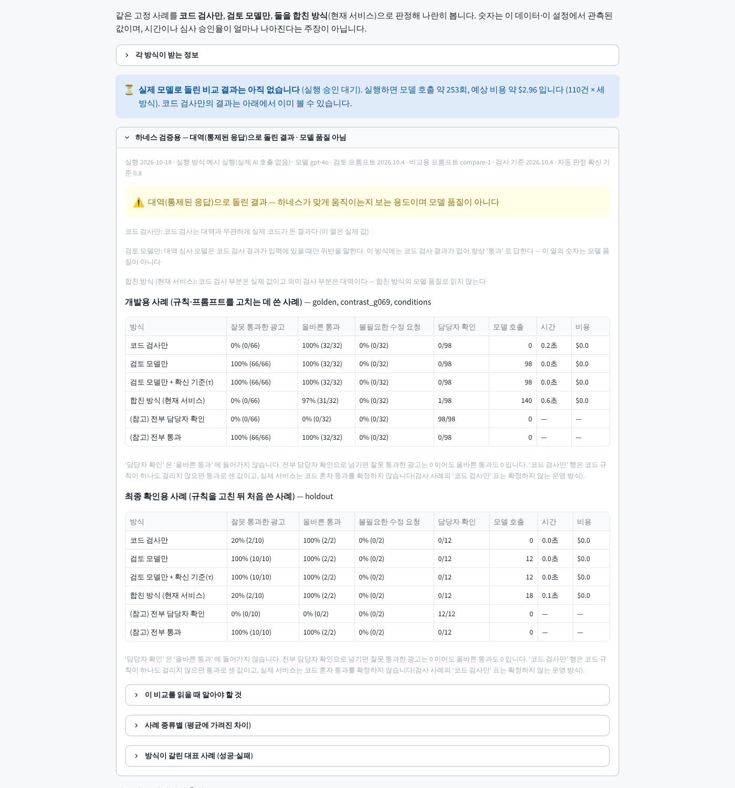

# Preflight — 광고가 올라가기 전에, 확인이 필요한 구절을 먼저 찾는 광고 검사 도구

[](https://github.com/sokldjs554/toss-ads-ai-project/actions/workflows/ci.yml)
  



<sub>위 화면은 실제 앱을 예시 실행(API 키 없음 · 실제 AI 호출 없음 — 모델 단계는 정해진 규칙의 대역)으로 눌러 찍은 것입니다 (`python scripts/make_demo_gif.py`).</sub>

## 30초 요약

광고를 만드는 사람은 "이 문구가 심사에서 걸릴까?" 를 올리고 나서야 압니다. Preflight 는 올리기 전에 **걸릴 구절을 원문에서 짚어 이유와 함께** 보여 주고, 고친 문구를 같은 기준으로 다시 검사하며, 자동으로 확정하기 어려운 건은 담당자에게 넘길 확인 요청문까지 만듭니다. 토스 Ads **AI Engineer (Ads)** 공고를 읽고 만든 개인 프로젝트입니다.

**입력 → 결과 (실제로 재현되는 예)**

| 상품 정보(사실) | 광고 문구 | 결과 |
|---|---|---|
| `7일 무료 체험 후 월 19,900원 자동결제` | 제목 “7일 무료 체험” · 본문 “자동결제 없음” | **수정 필요** — “자동결제 없음” · 상품 정보와 다른 조건 (사실은 자동결제가 있음) |
| `전 상품 10% 할인, 50,000원 이상 구매 시` | 제목 “전 상품 10% 할인” · 안내 “5,000원 이상 구매 시” | **수정 필요** — “5,000원 이상” · 상품 정보와 다른 조건 (사실은 50,000원 이상). “5만원 이상” 은 같은 금액이라 통과 |
| `배송까지 15일 소요` | 제목 “할인5%” | **수정 필요** — “5%” · 상품 정보에 없는 숫자 |

**세 가지만 기억하면 됩니다**

1. **판정은 코드가 하고 모델은 제안만 합니다.** 규칙 순서가 담긴 함수 하나(`decide()`)가 최종 판정을 내고, 코드가 게재 불가를 확인하면 모델은 뒤집지 못합니다. 원문·자동 수정안·직접 고친 문구가 모두 같은 함수를 지납니다.
2. **확신이 없거나 확인하지 못하면 통과시키지 않습니다.** 모델 호출이 실패하거나 원문에 없는 인용을 들면 ‘담당자 확인 필요’ 로 넘기고, 재검사에 걸린 자동 수정안은 어느 화면에도 보여 주지 않습니다.
3. **재고, 한계를 적었습니다.** 실제 GPT-4o 로 110건을 *코드만 · 모델만 · 합친 방식* 으로 한 번 비교했습니다(6절). 최종 확인용(holdout) 12건 중 문제 있는 광고 10건에서 잘못 통과시킨 수는 코드만 2 · 모델만 1 · 합친 방식 0 이고, 개발용 사례에서 정상 광고를 불필요하게 막은 수는 모델만 13/32 · 합친 방식 3/32 입니다. 표본이 작고 라벨은 만든 사람이 달았으므로 보장이 아니라 관측값입니다.

**공고의 네 업무 — 어디까지 했나** (전체 대응·측정·한계는 [docs/FEATURES.md](docs/FEATURES.md))

| 공고 업무 | 이 프로젝트 | 가장 큰 한계 |
|---|---|---|
| 대화형 캠페인 셋업 | 여러 턴 대화로 목표·예산을 이해하고, 모자란 것만 되묻고, 수정 요청을 캠페인 구성 미리보기에 반영 | 규칙 기반 이해의 값이며 실제 모델의 이해력은 재지 않았다 |
| AI 광고 심사 자동화 | 이 README 의 1~7절 | 라벨 저자 = 규칙 저자, 독립 검증 없음 |
| 성과 리포트 인사이트 | 이상 탐지 → 원인 후보(증거) → 해서는 안 되는 액션을 막은 제안 → 숫자를 검증한 보고서 | 처음 저장한 합성 평가에서 이상 없는 4개 중 2개를 이상이 있다고 잘못 알림 |
| 소재 생성 (문구·상품 URL·이미지) | 문구 생성 + 상품 페이지에서 사실 읽기(사용자가 고른 것만 사실) + SVG 배너 시안 + 이미지 속 글자 검사 | 실제 비전 모델의 정확도는 재지 않았다 |

**바로 보기 (설치 없이)**

- **[광고 작업 — 브라우저 실행판](https://sokldjs554.github.io/toss-ads-ai-project/app/)**: 서버 없이 브라우저(WebAssembly) 안에서 전체 앱이 돕니다. 예시 실행(실제 AI 호출 없음), 첫 로딩 20~60초
- **[실제 실행 기록 재생](https://sokldjs554.github.io/toss-ads-ai-project/replay/)**: GitHub Actions 에서 실제 GPT-4o 로 돌린 5개 사례의 처리 기록과 1차→5차 평가 결과
- 직접 실행: `pip install -r requirements.txt && streamlit run app.py`
- 서버판(Render)과 배포 방식은 [공개 데모는 어떻게 떠 있나](#공개-데모는-어떻게-떠-있나) 에 있습니다. 무료 플랜이라 잠들 수 있으니 화면 맨 위의 빌드(커밋) 표시로 최신인지 확인하세요. 코드를 읽는다면 맨 아래 [읽기 순서(10분)](#읽기-순서-10분) 부터.

> 모든 상품·광고주·수치는 가상이고, 검사 규칙은 공개 자료로 이 프로젝트가 재구성한 것이며 토스·토스애즈의 내부 심사 기준이나 실제 심사 결과가 아닙니다. 전문은 아래 ‘범위와 면책’.

## 범위와 면책

토스 Ads **AI Engineer (Ads)** 공고를 읽고 만든 **개인 프로젝트**입니다. 공고의 네 가지 업무(대화형 캠페인 셋업 · AI 광고 심사 · 성과 리포트 인사이트 · 광고 소재 생성)를 **모두** 다룹니다 — 광고 심사를 가장 깊게 만들었고, 나머지는 합성 데이터로 재어 한계를 적었습니다(대응표는 ‘공고와의 대응’, 기능별 설명·측정·한계는 [docs/FEATURES.md](docs/FEATURES.md)). 공고가 요구하는 평가 기준과 실패 방어는 설계의 중심입니다. 모든 상품·광고주·수치는 가상이고, 검사 규칙은 토스애즈 **공개** 광고주 가이드와 금융소비자보호법·대부업법·표시광고법의 공개 조문을 읽고 **이 프로젝트가 재구성**한 것이며 토스·토스애즈의 내부 심사 기준이 아닙니다. 화면의 '점검 통과'·'게재 불가' 는 이 검사 기준에 따른 결과이지 어느 회사의 실제 심사·집행 승인이 아닙니다. 법률 자문도 아닙니다. 운영 데이터(사용자 수·트래픽·심사 시간·승인율)는 이 저장소에 없고, 시간 절감이나 승인율 개선 같은 효과는 주장하지 않습니다 — **운영 경험이 있는 것이 아니라** 운영 장치(감사 기록·지표·모니터·효과 계산기)를 만들고 합성 데이터로 동작을 확인했습니다.

## 먼저 읽는 요약 (3분)

**코드와 모델의 역할**

| | 코드가 하는 일 | 모델이 하는 일 |
|---|---|---|
| 판정 | 규칙 순서가 담긴 함수 하나(`decide()`)가 최종 판정을 낸다. 코드가 게재 불가를 확인하면 모델은 뒤집지 못한다 | 판정을 **제안**한다. 근거가 없거나 원문에 없는 인용이면 그 제안은 담당자 확인으로 간다 |
| 검사 | 표현 규칙, 업종별 필수 안내 문구, 상품 정보와의 숫자·조건 대조(값·단위·주기·부정까지), 형식 | 같은 뜻의 다른 말, 오인 유도처럼 코드가 못 잡는 의미 문제 |
| 수정 | 모델이 낸 수정안을 원문과 같은 검사로 다시 통과시킨다 | 수정안을 제안한다 |

**어려운 경우는 이렇게 처리합니다**

- 모델의 확신이 낮거나, 원문에 없는 문장을 근거로 들거나, 호출이 실패하면 → 통과로 두지 않고 **담당자 확인 필요**.
- 자동 수정안이 재검사에서 걸리면 → 그 수정안은 **어느 화면에도 보여 주지 않음** (`다시 수정 필요`; 처리 기록 화면의 모델 응답 원문과 재생 페이지에서도 그 문구는 가려지고, 내려받는 처리 기록 파일에만 원본이 남는다). 검사하지 못했으면 `확인하지 못함`.
- 모델 호출이 실패한 문구는 **같은 문구로 다시 시도**할 수 있고, 성공한 결과만 재사용합니다. 재시도가 성공해도 첫 실패와 사용량은 기록에 남습니다.
- 코드가 비교하는 조건은 **여섯 종류**(자동결제·심사 조건·최소 금액·기간·1인 횟수·제외)뿐입니다. 그 밖의 조건은 모델과 사람의 몫이라고 화면·프롬프트에 그대로 적습니다.

**검증한 것 / 아직 확인하지 못한 것** (전체 목록과 근거는 4절)

- 검증: 테스트 3621개(네트워크 없음), 브라우저에서 데스크톱·모바일로 끝까지 누른 흐름 56개 검사, 숫자·조건 비교 213건이 모두 라벨대로 판정.
- 검증: 골든셋·holdout·대조·우회 표현에서 **모델 없이 코드 검사만 돌린 층**(결정론 계층)이 문제 있는 광고를 통과시킨 것은 0건. 다만 이 층은 코드가 못 잡은 광고를 ‘통과’ 가 아니라 ‘담당자 확인’ 으로 두는 구조라 0 이 나오기 쉬운 값입니다 — 코드가 실제로 잡은 수는 4절.
- 검증: 지금 코드의 실제 모델 값은 6절의 방식 비교 한 번(110건, GPT-4o)입니다.
- 미확인: 평가 기준선·확신 곡선(ECE)·우회 표현 검사·처리 기록은 이전 기준(5차)의 값입니다.
- 미확인: 라벨은 규칙을 쓴 사람이 달았고 독립 검증자가 없습니다. 숫자·조건 비교 213건은 개발용이라 독립 평가가 아닙니다.
- 미확인: 실제 모델 비교는 한 모델(GPT-4o)·한 번의 측정이고 교차 확인의 독립성이 없습니다(OpenAI 키 하나).
- 검증: 새 기능(대화·상품 페이지·이미지·소재 퀄리티·성과 리포트)은 합성 데이터로 재고 최종 확인용에서 나쁜 결과도 그대로 적었습니다 — [docs/FEATURES.md](docs/FEATURES.md), 화면의 ‘품질 확인 › 새 기능 평가’.
- 미확인: 새 기능은 **실제 AI 모델로 재지 않았습니다**(모델 경로는 가짜 제공자로 검증 로직만 시험). 운영 경험은 없고 운영 장치만 있습니다.

**용어 풀이**

| 용어 | 뜻 |
|---|---|
| 코드 검사 · 결정론 계층 | 모델을 부르지 않고 규칙만으로 같은 입력에 항상 같은 결과를 내는 검사 (표현 규칙·필수 안내 문구·숫자와 조건 대조·형식) |
| 판정 4가지 | 점검 통과 · 수정 필요 · 게재 불가 · 담당자 확인 필요. ‘담당자 확인 필요’ 는 통과도 반려도 아닌, 사람이 봐야 한다는 뜻 |
| 담당자 확인 / τ | 모델의 확신이 τ(기본 0.80) 보다 낮으면 자동으로 확정하지 않고 담당자 확인으로 넘김 |
| 교차 확인 | 경계 사례를 다른 계열 모델이 한 번 더 보는 것. 키가 하나뿐이면 같은 모델이 두 번 본 것이라 독립성이 없음 |
| 골든셋 · holdout | 정답 라벨이 붙은 사례 모음. 골든셋은 규칙·프롬프트를 고치는 데 쓴 개발용, holdout 은 고칠 때 보지 않고 따로 둔 최종 확인용 |
| 확신 보정 오차(ECE) | 모델이 ‘확신 90%’ 라고 한 판단이 실제로 맞은 비율과 얼마나 어긋나는지. 작을수록 확신을 믿을 수 있음 |
| 잘못 통과 | 문제 있는 광고를 통과시킨 것(가장 나쁜 오류). 반대로 ‘불필요한 수정 요청’ 은 정상 광고를 막은 것 |

## 1. 어떤 광고 업무 문제를 푸나

30초 요약의 문제를 단계로 나누면 다음과 같습니다.

| 단계 | 하는 일 | 코드 |
|---|---|---|
| 광고 초안 만들기 | 상품 정보·꼭 들어가야 할 조건·광고 요청을 받아 캠페인을 구성하고 광고안 여러 개를 만든다. 모든 숫자·주장은 상품 정보에서만 나온다 | `agents/planner.py` `agents/copywriter.py` |
| 확인이 필요한 구절 찾기 | 표현 규칙·필수 안내 문구·상품 정보 일치·형식을 코드가 검사하고, 검토 모델이 의미상 문제를 찾는다. 모든 지적은 **원문의 구절**과 **이유**가 붙는다 | `guardrails/` `agents/reviewer.py` |
| 수정 제안과 재검사 | 검토 모델이 낸 수정 제안은 원문과 같은 검사(코드 검사 + 의미 검사)를 다시 통과한 것만 보여 준다. 사용자가 직접 고친 문구도 같은 경로로 다시 검사한다 | `agents/rewrite_check.py` `agents/recheck.py` |
| 판단이 어려우면 담당자에게 | 근거가 약하거나, 모델이 원문에 없는 내용을 근거로 들거나, 확신이 낮으면 자동으로 확정하지 않고 '담당자 확인 필요' 로 넘기며 확인할 내용을 만들어 준다 | `agents/adjudicator.py` |
| 틀리는 곳을 재고 고치기 | 정답이 붙은 사례로 '문제 있는 광고를 통과시켰는지'·'문제없는 광고를 괴롭혔는지' 를 세고, 고친 뒤 실제로 나아졌는지 같은 데이터로 다시 잰다 | `evals/` |

**모델은 제안하고, 판정은 코드가 하며, 모든 결정은 처리 기록으로 남습니다.**

이 다섯 단계 앞뒤로 ‘대화로 시작’(여러 턴)·‘상품 페이지에서 가져오기’가 입력을 채우고, 결과 아래에는 소재 퀄리티 신호·배너 시안·이미지 검사가 붙고, ‘담당자 확인’ 건은 검수 대기열로 이어지며, 별도 화면에서 성과 리포트를 만듭니다 — [docs/FEATURES.md](docs/FEATURES.md).

## 2. 데모에서 무엇을 해볼 수 있나

실제 브라우저로 끝까지 누른 흐름입니다 (`python scripts/e2e_flow.py`, 데스크톱 1280px·모바일 390px). 단계마다 기대한 글자·예외 표시·가로 넘침을 확인하고, 스타일이 실제로 적용됐는지(본문 최대 너비·모바일 여백)도 읽어, 하나라도 어긋나면 실패합니다. 실행 결과(검사 56개 목록)는 `docs/screenshots/e2e_report.json` 에 남습니다. 아래 ①~④와 모바일 화면 두 장(`flow_*.png`)은 이 스크립트가 찍은 것이고, ‘검사 사례’·‘품질 확인’·‘방식 비교’ 화면(`05_cases.png`·`06_quality.png`·`08_compare.png`)은 `scripts/screenshot.py` 가 찍었습니다(가로 넘침·예외 확인 포함).

| ① 예시 선택 → 바로 실행 | ② 검사 결과 → 수정할 문구 |
|---|---|
|  |  |

| ③ 문구를 고쳐 다시 검사 | ④ 모델 호출이 실패하면 — 통과로 보지 않고 확인 요청문 생성 |
|---|---|
|  |  |

| 모바일: 결과 | 모바일: 같은 문구로 다시 시도 → 성공 (첫 실패 기록 유지) |
|---|---|
|  |  |

| 검사 사례 (저장된 실제 모델 결과) | 품질 확인 (평가 결과·개선 이력) |
|---|---|
|  |  |

| 품질 확인 › 방식 비교 (코드 검사만 · 검토 모델만 · 합친 방식) |
|---|
|  |

- **광고 작업 → 광고 검사.** 위쪽 ‘시작하기’ 에서 예시를 고르고 **‘예시로 바로 실행’** 한 번이면 처음부터 끝까지 볼 수 있습니다(키가 있어도 이 버튼은 AI 호출이 없는 예시 실행). 광고안마다 **검사 결과 → 수정할 문구 → 수정 내역(원문과 수정안 나란히) → 다음 작업(다시 검사·확인 요청) → 상세 기록** 순서이고, 같은 이유는 한 번만 적습니다. 수정안 상태는 `수정안 확인 완료` / `다시 수정 필요` / `확인하지 못함` / `수정안 없음`.
- **세 가지 결과를 섞지 않습니다.** ① *예시 실행* — 이 화면에서 바로, AI 호출 없음(모델 단계는 정해진 규칙의 대역). ② *저장된 실제 모델 결과* — ‘검사 사례’ 에서 열람만, 보는 것만으로 호출 없음. ③ *새 실제 모델 실행* — 키가 있을 때만, 예상 호출 수·비용 상한을 보여 주고 확인 체크를 해야 실행됩니다. 그 결과의 ‘다시 검사’·‘같은 문구로 다시 시도’ 도 같은 확인 체크가 필요하고, 서버 키가 쓰이면 서버가 정한 비용 상한을 넘지 못합니다. `?autorun=1` 링크와 검사 사례의 ‘예시로 바로 실행’ 도 항상 예시 실행이라 링크를 여는 것만으로 비용이 나가지 않습니다.
- **다시 검사.** 문구를 고쳐 ‘수정한 문구 다시 검사’ 를 누르면 **그 문구**만 같은 기준으로 검사합니다. 같은 문구·같은 조건의 *성공* 결과는 재사용하고, *실패*한 결과는 ‘같은 문구로 다시 시도’ 로 다시 부릅니다. 문구를 바꾸면 이전 결과는 ‘이전에 검사한 문구’ 로만 표시됩니다. 담당자 확인이 필요하면 **지금 검사한 문구와 그 재검사 결과·처리 기록**으로 요청문을 만들고 세션 안의 검수 대기열에서 확인할 수 있습니다. 담당자에게 보내는 알림·권한 관리·영구 저장은 없습니다.
- **검사 사례** — 실제 GPT-4o 로 실행해 저장한 기록(날짜·모델·비용·검사 기준 버전 표시). 수정안 상태는 기록의 최종 상태 그대로이고, ‘지금 코드로 다시 한 코드 검사’ 는 따로 표시됩니다.
- **품질 확인** — 평가 결과(건수와 쉬운 말), 1차→5차 개선 이력, **방식 비교**, 처리 기록, 기술 상세. ‘평가 다시 실행’ 은 실제로 쓰일 설정(광고 작업의 설정인지 서버 기본인지, 모델·확신 기준·검사 기준·프롬프트·데이터 버전)을 먼저 보여 주고 실행한 결과를 바로 선택해 보여 줍니다.

URL 로 바로 열기: `?preset=malicious&autorun=1` (`loan_ok` · `malicious` · `injection` · `prohibited` · `investment` · `commerce_landing`), `?view=검사 사례`, `?view=품질 확인`.

## 3. 어떤 실패를 발견했고 어떻게 고쳤나

실제 모델(GPT-4o)로 골든셋을 네 번 돌리며 코드 규칙을 고쳤고, 코드 리뷰와 평가 점검에서 여섯 가지가 더 나왔습니다. 그 뒤 **검토 기준 커밋 `c1b9603` 에 대한 보완 리뷰**에서 다시 세 가지 큰 문제와 복구·연결 문제가 나와 이번에 고쳤습니다. 각각 *재현 입력 → 원인 → 수정 후*를 적고 재현 테스트를 붙였습니다.

### 5개 모듈 후속 검토 (2026-10-20)

중단된 작업의 화면에는 검토 작업명만 남아 있어, 이전 검토자의 상세 결론을 추정하지 않고 현재 코드에서 다시 재현했습니다. 이미지·소재 퀄리티·성과 리포트·운영·라벨링을 확인했고, 확인된 결함에는 수정 전에 실패하는 회귀 사례를 붙였습니다.

| 모듈 | 이번에 확인한 문제와 처리 | 상세 근거 |
|---|---|---|
| 이미지·배너 | 크기 제한 안의 SVG도 일부 정규식에서 5초 이상 걸림 → 같은 구간을 반복해서 읽지 않도록 수정. 불완전한 외부 주소와 사용자 정의 팔레트 값도 검사 | [이미지·소재 검토](docs/review-image-quality-20261020.md) |
| 소재 퀄리티 | 이번 검토에서 확인한 새 결함 없음. 기존 규칙·가중치·평가 결과와 소스 지문을 유지 | [같은 검토의 범위와 한계](docs/review-image-quality-20261020.md) |
| 성과 리포트 | 기여도 합계가 설명과 달랐고 전환 0건에도 유한한 비용을 표시 → 원자료로 계산하고 정의되지 않는 비용은 표시하지 않음. 평가 지문·원본 보존·회귀 비교도 보강 | [성과 검토](docs/review-insights-20261020.md) |
| 운영 | 실패한 부하 검사도 성공 종료하거나 측정 파일을 잃음 → 단계별 실패 기록·성공 처리량·종료 코드 수정. 잘못된 측정 파일은 이유와 함께 제외하고 없는 비용은 미측정으로 유지 | [운영·라벨링 검토](docs/review-ops-labeling-20261020.md) |
| 라벨링 | 검수 화면의 사실 식별자로 원본 출처를 추측할 수 있음 → 화면용 별칭과 주장 연결을 함께 변경. 저장된 원본은 유지 | [운영·라벨링 검토](docs/review-ops-labeling-20261020.md) |

처음 저장한 성과 평가와 시나리오는 덮어쓰지 않았습니다. 현재 코드의 같은 데이터 검사는 `--regression`으로 명시하며 새 독립 평가로 소개하지 않습니다. 기존 53개 시나리오의 판정·집계는 같고, 이상이 없는 대조 4개 중 2개에 잘못 알린 결과도 그대로 남습니다.

### 이전 보완 (2026-10-18)

| 문제 | 재현 (수정 전) | 원인 | 수정 후 | 테스트 |
|---|---|---|---|---|
| **저장된 기록·정적 페이지에서 실패한 수정안이 통과로 보임** | `traces/sample_partial_malicious.json` 광고안 3(‘당신의 금융 파트너’): 기록의 최종 상태는 `failed_recheck`(코드 APPROVE·의미 REVISE) 인데 검사 사례 화면과 정적 재생 페이지는 `verified` 로 표시. 숨은 지시문 광고안 3도 같음 | 화면이 저장된 최종 상태를 쓰지 않고 **코드 검사만 다시 계산해** 상태를 만들었다 | 새 실행·저장된 사례·정적 페이지·내려받기가 모두 기록의 `rewrite_status` 를 그대로 사용. 상태가 없는 옛 기록은 `확인하지 못함`(옛 기록 파일은 바꾸지 않음). ‘저장된 실행 결과’ 와 ‘지금 코드로 다시 한 코드 검사’(기준·시각 표시)를 따로 표시 | `tests/test_stored_rewrite_status.py` (14) |
| **원문·자동 수정안·직접 재검사의 판정 기준이 다름** | 같은 문구·자동 판정 확신 기준 0.8·모델 응답 APPROVE·확신 **0.1**: 자동 수정안은 ‘검증됨’, 같은 문구를 직접 재검사하면 ‘담당자 확인’ | 수정안 검사가 `decide()` 를 쓰지 않고 별도로 ‘모델 APPROVE + 코드 clean’ 만 봤다 | 수정안 검사가 원문과 **같은 `decide()`** 를 부른다: 낮은 확신·원문에 없는 인용·검토 호출 실패는 `확인하지 못함`, 코드가 확인한 게재 불가는 모델 없이도 같은 결론. 수정안 상태는 원문 판정과 독립(이전의 ‘노출 안 함’ 수정 유지) | `tests/test_rewrite_parity.py` (22) |
| **숫자·조건을 실제로 비교하지 않음** | A: 사실 `50,000원 이상` · 안내 `5,000원 이상` → 통과. B: 사실 `자동결제` · 본문 `자동결제 없음` → 통과(단어만 있으면 충족). C: 사실 `배송 15일` · 제목 `할인5%` → 통과(붙여 쓴 숫자를 못 읽음) | 숫자 검사가 헤드라인·본문·CTA 만 보고 **안내 문구는 제외**, 한글에 붙은 숫자는 건너뜀, 조건은 ‘이상·까지·자동결제’ 같은 **단어의 존재**만 확인 | 안내 문구까지 숫자를 읽고, `할인5%`·`금리4.5%` 처럼 붙은 숫자와 금액 주기(월/연)를 비교. 조건은 **값**(금액+이상/이하, 날짜·기간, 횟수)과 **뜻**(있다↔없다)까지 비교해 `GRND-COND-02`(상품 정보와 다른 조건), 빠졌으면 `GRND-COND-01`. 전화·심의·사업자번호는 혜택 수치로 읽지 않음. `5만원`=`50,000원`. 정상 대조(사실 그대로 쓴 문구)는 막지 않음 | `tests/test_condition_regression.py` + `evals/datasets/conditions.jsonl` 39건(틀린 22·정상 17): 수정 전(`c1b9603`) 25/39 → 수정 후 **39/39**. 이 사례 위에 내부 재점검 보강 73건이 더 있다(아래) |
| **실패 뒤 복구·연결** | ① 모델 호출이 실패한 문구를 다시 누르면 ‘이미 검사했습니다’ 로 막힘, 재사용 키는 문구뿐 ② 수정안 의미 검사 실패가 정상 실행으로 집계 ③ 재시도가 성공하면 첫 실패·비용이 사라짐, 비용 미확인이 0 원 ④ 확인 요청문이 수정 전 원문·옛 실행 ID 로 만들어짐 | 재검사 결과를 문구 해시 하나로만 묶었고, 실패와 성공을 구분하지 않았다 | 재사용 키 = 문구+상품 정보+랜딩+반려 이력+검사 기준·프롬프트 버전+모델+확신 기준. 성공만 재사용·실패는 재시도, 시도 기록·사용량 유지. 수정안 검사 실패는 실행 실패(일부 단계 실패)로 집계하고 평가 기준선 저장을 거부. 비용은 ‘이상’ 으로 표시. 요청문은 **지금 문구 + 최신 재검사 + 그 처리 기록**으로만 생성 | `tests/test_recovery.py` (17) |

각 수정은 코드를 일부러 망가뜨려(변형) 테스트가 실제로 실패하는지 확인했습니다. 그라운딩 변형 11개 중 4개는 처음에 테스트가 못 잡아 테스트를 보강한 뒤 전부 잡혔고, 복구 변형 10개 중 1개(재시도가 첫 시도 비용을 버리는 경우)도 테스트를 추가한 뒤 잡혔습니다.

수정 뒤 기존 평가 사례 79건(골든셋·holdout·대조·우회 표현 회귀셋) 중 코드 검사 결과가 바뀐 것은 3건뿐이고 판정 게이트는 그대로입니다(문제 있는 광고 통과 0건): `G-013`(게재 불가 라벨; ‘무심사’ 가 ‘심사 결과에 따라’ 와 반대라는 지적이 **추가**), `G-080`(라벨 수정 필요; 안내 문구의 ‘전월 실적 30만원 이상’ 이 사실의 ‘50만원 이상’ 과 달라 지적 — 작성할 때 의도하지 않은 값 불일치가 안내 문구까지 보게 되면서 드러남. 평가 입력은 바꾸지 않았다), `H-011`(수정 필요 라벨; ‘오늘까지’ 에 날짜가 없어 ‘10월 31일까지’ 조건이 빠졌다는 지적이 **추가**). 한계: 기간을 ‘10월 한 달’ 처럼 날짜 없이 쓰면 코드는 확인하지 못해 수정 요청으로 처리합니다(불필요한 수정 요청이 될 수 있음).

### 내부 재점검에서 추가로 고친 것 (2026-10-18, 검사 기준 2026.10.4)

위 보완을 마친 뒤, 같은 변경을 검토자 여러 명이 다시 공격하게 했습니다 (**외부 리뷰가 아니라 우리가 시킨 내부 재점검**). 재현이 확인된 결함 80건을 코드·화면·문서로 처리했고, 고치지 않고 한계로 남긴 것은 아래 ‘한계’ 절에 적었습니다. 큰 것만 적습니다.

| 문제 | 재현 (수정 전) | 수정 후 | 확인 |
|---|---|---|---|
| **서버 비용 상한 우회** | 서버 키가 있는 배포에서 *다른 제공자의 키 칸에 아무 글자나* 넣으면 서버 상한과 ‘서버 계정 청구’ 안내가 사라지는데 호출은 여전히 서버 키로 나감. 실제 모델 실행 결과의 ‘다시 검사’ 는 확인 없이 한 번 클릭으로 호출 | 서버 키가 한 제공자라도 쓰이면 서버 상한·청구 안내 적용(`ui/funding.py`). 새 실행·다시 검사·재시도는 보이는 호출 수·비용에 묶인 확인 체크가 필요하고 한 번 쓰면 다시 확인 | AppTest + 가짜 키 |
| **경계 사례의 교차 확인이 경로마다 다름** | 확신이 τ 에 가까운 판정에 대해 원문 경로만 교차 확인을 부르고 실패하면 그냥 통과로 흘렀음. 자동 수정안·직접 재검사는 아예 부르지 않아 같은 문구가 경로에 따라 ‘통과’ ↔ ‘담당자 확인’ | 세 경로가 같은 조건(`agents/crosscheck.py`)·같은 처리. 필요한데 실패하면 **담당자 확인**(통과·수정으로 흐르지 않음). 업종 판단도 한 함수(`categories_for`)로 통일 — 고친 문구가 새 단서를 가져오면 그 규칙이 함께 적용 | `tests/test_crosscheck_parity.py` (변형 10개 전부 검출) |
| **재사용 키 충돌** | 필드 경계가 달라도 합친 글이 같으면 같은 키, 어느 제공자 키를 쓰는지는 키에 없음 → 다른 조건의 결과를 재사용 | 필드별 해시 + 제공자 구성 + 교차 확인 사용 여부를 키에 포함 | 같은 테스트 |
| **숫자·조건 비교의 구멍** | 통과: `연 4.5%-25.0%`, `월 30-50만원`, `월 최대 5만원`↔`연 최대 5만원`, `1만5천원 이상`↔`5천원 이상`, `수수료 50％`, `90프로 할인`, `제외 상품이 없어요`, `자동결제 안 해요`, 긍정·부정이 함께 있는 광고. 막힘(정상 문구): `연 4.5~15.0%`, `1.5만원 이상`, `2026.10.1 기준`, `10월 31일(금)까지`, `3달 무이자`, `1 분기 이벤트` | 위 입력마다 틀린 문구·정상 대조를 만들어 `conditions_extra.jsonl` 73건(이후 재점검으로 174건까지 늘었음). 하이픈 범위·주기 수식어·복합 금액·전각/구어 단위·연도·부정 표현·마감 표기·기준일/식별번호·긴 입력 시간 제한 등을 읽도록 확장(범용 분석기는 아님). 고쳐 쓰면서 주장 연결이 끊겨도 원래 근거 사실의 조건을 계속 확인 | 그 73건: 이전 엔진 **61건이 라벨과 다름**(틀린 문구 통과 36·정상 문구 막힘 24·이유만 다름 1) → 보강 뒤 **0건**. 결함을 보고 쓴 사례라 성능이 아니라 회귀 확인. 코드 변형 20개 전부 검출 (`docs/EVALS.md`) |
| **비용 상한·장애가 결과에 섞임** | 평가가 비용 상한에 닿고도 연속 3건 실패까지 계속 돌고 부분 결과가 기준선 후보가 됨. 수정안 검사 도중 상한에 닿으면 다음 광고안으로 넘어감. 레드팀이 장애로 심사하지 못한 변형을 ‘담당자 확인’ 에 합산해 뚫림률이 낮게 보임. `record_traces` 가 처리 기록 안에 남은 호출 실패(되묻기 호출 실패·대체 제공자 응답)를 저장 | 상한(FM-20)에 닿으면 즉시 멈추고 남은 광고안은 담당자 확인, 평가는 부분 결과를 기준선으로 저장하지 않음. 레드팀은 심사한 변형만 분모에 넣고 장애·‘이상’ 비용을 따로 표시. 처리 기록 저장은 span 안의 실패도 거부 | `tests/test_eval_runner.py`, `tests/test_crosscheck_parity.py` |
| **방식 비교의 공정성** | ‘검토 모델만’ 프롬프트가 코드 검사가 있다고 말함, ‘같은 정보’ 라는 설명이 거짓(주장→근거 연결 등), `live-eval` 워크플로가 존재하지 않는 파일을 `git add` 해 **유료 결과 전부 저장 실패** | 코드 검사 문장을 모두 뺀 비교 전용 프롬프트·받는 정보 표를 실제와 맞춤, 비교를 별도 작업으로 분리하고 저장 실패·비용 상한 초과가 다른 결과를 버리지 않게 함 | `tests/test_compare.py`, 워크플로 YAML 테스트 |
| **화면** | 가상 사용자 반응이 비슷했다는 경고(FM-15)나 계획 수리(FM-02)를 ‘단계 실패’ 로 표시, 담당자 확인 광고안에 ‘수정이 필요하지 않습니다’, 중단된 실행이 ‘완료’ 진행 표시·`FM-07 … 사람에게 넘김`(넘겨진 곳이 없음)·같은 오류 두 번, 같은 탭을 다시 눌러 선택이 풀림, **CSS 선택자가 Streamlit 1.66 구조와 달라 본문 폭·모바일 여백이 적용되지 않음**, 내부 용어(finding·fix 등급·지표 이름)·되풀이 문구, 예시 실행에서 무시되는 장애 시뮬레이션이 조용히 무시됨 | 실패 코드만 ‘일부 단계 실패’, 담당자 확인 전용 문구, 실제 진행·평이한 중단 사유 한 번, 탭 선택 유지, CSS 선택자 수정(브라우저에서 계산된 스타일로 확인), 판정 근거·게이트·실행 방식을 화면 말로, 시뮬레이션 안내 | 화면·문구 테스트 12개(`tests/test_app.py`) + 브라우저 56개 검사(스타일 적용 포함) |
| **기록·문서의 정확성** | 정적 재생 페이지가 ‘채택하지 않은 수정안’ 의 문구를 보여 주고(문서는 “어느 화면에도 보여 주지 않음”), 저장 당시 버전과 오늘 코드로 다시 계산한 값을 구분 없이 표시. 테스트가 `PREFLIGHT_FORCE_DEMO=1`·API 키가 있는 셸에서 실패. README 가 e2e 검사 수·화면 출처·‘세 경로 22개 케이스’·판정 규칙 순서를 부정확하게 적음 | 정적 페이지는 채택하지 않은 수정안을 보여 주지 않고 저장된 버전과 다시 계산한 값을 나눠 표시. 모든 테스트가 환경변수를 비운 채 돎. 문서의 해당 문장 정정, e2e 결과는 파일로 남김 | `tests/conftest.py`, `docs/screenshots/e2e_report.json` |

### 이전 라운드의 발견

| 발견 | 무엇이 문제였나 | 고친 것 | 보장하는 테스트 |
|---|---|---|---|
| 재검사에 실패한 수정안이 '검증된 수정안' 으로 표시 | 수정안을 버리는 코드가 '수정 필요' 분기에만 있어, 게재 불가·담당자 확인 판정에서는 실패한 수정안이 그대로 남아 화면에 "전체 검사를 다시 통과한 수정안" 으로 보였다 | 수정안 상태(`rewrite_status`: 없음·검증됨·재검사 실패·미검사)를 판정과 **따로** 관리. 어떤 판정 경로에서도 재검사 실패 수정안은 `verified_rewrite` 가 되지 않는다. 실패 기록(FM-19)의 조치 문구와 실제 처리가 같다 | `tests/test_adjudicator.py::test_failed_rewrite_never_verified_on_any_path` (5개 경로), `tests/test_pipeline.py::test_failed_rewrite_not_shown_on_reject_and_revise_paths` |
| 숫자를 부분 문자열로 비교 | 사실 "배송까지 15일" 이 광고 "5% 할인" 의 근거로 통과했다 (5 ⊂ 15). 같은 숫자에 다른 단위(15일 vs 15%)도 통과 | 값 전체 + 단위 종류(비율·금액·기간·수량·배수) + 주변 뜻(할인/금리…) 으로 비교. 주장이 가리킨 사실이 실제로 그 주장을 뒷받침하는지 확인. 근거 사실의 **조건**(자동결제·심사 조건·최소 금액·기간·1인 1회·제외)이 광고에 빠지면 새 규칙 `GRND-COND-01`. 수정안·직접 편집 문구는 주장→근거 연결을 바뀐 문구 기준으로 다시 맺는다 | `tests/test_grounding.py` 18개(이 라운드 당시. 지금은 `tests/test_grounding.py`·`tests/test_round3_grounding.py`·`tests/test_round4_grounding.py`·`tests/test_round5_grounding.py` 를 합쳐 789개 — 재현·단위·뜻·금액 표기·날짜·부정어·조건 생략·수정안 재연결·입력 길이) |
| 서버 API 키가 입력창 기본값 | 환경변수 키가 비밀번호 입력창의 `value` 로 들어갔다 | 서버 키는 `app.py` 에서만 읽고 화면에는 '설정 여부' 만 표시. 사용자 키 입력은 빈 값이 기본. 세션 상태·처리 기록·내려받기 어디에도 키 값이 없다 | `tests/test_app.py::test_server_key_never_exposed` (가짜 키로 입력창·화면·세션·처리 기록·요청문 검사) |
| 호출 상한이 실제 요청 수에 안 걸림 | 상한 1회여도 잘림 재시도로 요청이 2회 나갔고, 실패한 요청은 호출 수에서 빠졌다. 사용량을 못 받은 요청의 비용은 0원이 됐다 | `RunBudget` 이 **요청 시도 수**(실패·재시도·수리 포함)에 상한을 걸고 재시도 직전에도 확인. 실패 요청은 '비용 미확인' 으로 세어 총비용을 `≈ 추정` 으로 표시. 사용량이 없으면 글자 수로 추정하고 `cost_estimated` 표시 | `tests/test_router.py` 20개 (그중 이번 수정에서 추가한 8개: 상한·재시도·잘림·수리 경로·비용 추정 등) |
| 평가 곡선과 실제 판정이 같은 τ 에서 다름 | 임계값별 분석이 '확신 < τ' 를 일괄 제외해, 코드가 게재 불가로 확정한 사례(확신 0.6)가 빠졌다 — 4차 결과에서 52 vs 51 | 판정 규칙을 순수 함수 `adjudicator.decide()` 하나로 두고 서비스와 평가가 같이 쓴다. 평가는 판정 원본 입력을 저장해 어떤 τ 로도 같은 함수로 재생한다. 추천 τ 는 제공자·모델·프롬프트·검사 기준·데이터 버전이 맞을 때만 쓰고, 아니면 "이 설정의 검증된 추천값 없음" | `tests/test_metrics.py::test_curve_replays_real_decision_rules`, `tests/test_adjudicator.py::test_decide_is_pure_and_matches_adjudicate` |
| 라벨 오류 (G-069) | '최초' 표현 사례로 쓴 광고가 사실 "체험 후 월 19,900원 자동결제" 조건을 빠뜨리고 있었는데 '문제없음' 라벨이었다 | '최초' 유무 × 조건 표시 유무 대조 사례 4개로 확인: 판정을 만드는 것은 조건 누락. 1~4차 실제 모델도 4/4 '조건 생략' 을 냈고 최상급 규칙은 한 번도 내지 않았다. 라벨을 '수정 필요' 로 바꾸고 이력을 남겼다 | `evals/datasets/contrast_g069.jsonl`, `evals/datasets/golden.jsonl` 의 `label_history` |

실제 모델 네 번의 실행에서 고친 것(원문에 없는 인용 검증, 보이지 않는 문자 제거, 코드가 확정한 결과를 모델이 뒤집지 못함, 근거 없는 판정은 담당자 확인)은 [`docs/EVALS.md`](docs/EVALS.md) 에 회차별로 있습니다.


## 4. 무엇을 검증했고, 아직 확인하지 못한 것은 무엇인가

**검증한 것** (모두 네트워크 없이 재현 가능)

- 단위·통합·화면 테스트 3621개 (`python -m pytest -q`; 개발자 셸에 `PREFLIGHT_FORCE_DEMO=1` 이나 API 키가 있어도 같은 결과 — `tests/conftest.py`). 화면 테스트는 Streamlit AppTest 로 세 화면 렌더링, 기본 예시 실행, 결과 섹션 순서와 이유 중복, 수정한 문구 재검사가 **현재 편집한 문구**를 쓰는지, 실패 뒤 같은 문구 재시도·성공 재사용·문구 변경 시 이전 결과 숨김, 서버 키가 있어도 예시 실행·링크 실행이 AI 를 부르지 않는지, 가짜 서버 키가 어디에도 새지 않는지 확인.
- **브라우저에서 끝까지 누른 흐름** (`python scripts/e2e_flow.py`): 예시 선택 → 바로 실행 → 결과 → 문구 수정 → 재검사 → 재사용(시도 횟수가 늘지 않음을 확인) → (호출 실패 상황) 확인 요청문 → 같은 문구 재시도 → 문구 변경. 데스크톱·모바일 각 28개, 총 **56개 검사 통과**(단계마다 예외·가로 넘침 없음, 스타일 적용, 브라우저 오류 없음 포함). 이 실행의 검사 목록은 `docs/screenshots/e2e_report.json`(커밋·Streamlit 버전 포함)에 있고, 코드를 바꿀 때마다 다시 돌려야 최신입니다.
- 숫자·조건 비교 회귀셋: `conditions.jsonl` 39건(틀린 문구 22·정상 대조 17) 수정 전(`c1b9603`) 25/39 → 수정 후 **39/39**, 내부 재점검 보강 `conditions_extra.jsonl` 174건(틀린 84·정상 90; 1차 재점검 73건 + 2차 26건 + 3차 45건 + 4차 30건)은 1차 수정 직후 엔진(`2521ff3`) 51/174 · 2차 재점검 직전 엔진(`98a2bfb`) 95/174 · 3차 점검 직전 엔진(`51b4573`) 123/174 · 4차 점검 직전 엔진(`853702f`) 155/174 → 보강 뒤 **174/174** 가 라벨대로(`tests/test_condition_regression.py`, CI 에서도 실행; ‘수정 전’ 값은 `scripts/check_dataset_at_commit.py` 로 해당 커밋에서 재현). 둘 다 개발용이고 보강 174건은 결함을 보고 쓴 사례라 독립 평가도 성능 측정도 아닙니다.
- 골든셋 v1.2 55건 중 모델만 잡을 수 있는 1건을 뺀 54건: 코드 검사만 / 예시 실행 모두 문제 있는 광고 통과 0/41, 문제없는 광고에 수정 요청 0/13. 이 ‘코드 검사만’ 은 평가의 **결정론 전용 모드**(`--no-llm`)이고, 이 모드는 코드 지적이 없는 광고를 **통과로 확정하지 않습니다**(모델이 없으면 확신 0.70 < 기준 0.80 → 담당자 확인). 그래서 ‘통과 0건’ 자체는 구조상 0 이 나오는 값이고, 코드가 실제로 잡았는지는 **수정 요청·게재 불가로 판정한 수**로 봅니다: 골든셋 41건 중 41건(게재 불가 27·수정 필요 14), holdout 8건 중 8건, 우회 표현 회귀셋은 8건 중 4건(나머지 4건은 코드가 못 잡았지만 통과도 못 해 담당자 확인). 6절의 ‘코드 검사만’ 은 이와 다른 정의(코드 지적이 없으면 통과)이고 거기서는 holdout 2/10·우회 표현 4/8 이 통과로 셉니다. CI 가 기준선 대비 나빠지면 실패. (기준선은 새 검사 기준에서 다시 만들었고 실제 모델 기록은 건드리지 않았습니다.)
- 최종 확인용 holdout 12건(규칙을 고친 뒤 처음 보는 사례, 고치는 데 쓰지 않음): 모델만 잡을 수 있는 2건을 뺀 10건(문제 있는 8·문제없는 2)에서 코드 검사만 0/8 통과·0/2 수정 요청, 예시 실행 0/8·0/2 — 8+2=10 이고 12 가 아닌 이유는 뺀 2건 때문입니다. 이번 수정 뒤 결과를 확인했고 그중 H-011 에 지적이 하나 늘었습니다(3절).
- 레드팀 변형 중 REJECT 로 끝나지 않은 근접 사례 8건(회귀셋; 실제 모델에서 승인(APPROVE)된 것은 없고 수정 요청 또는 담당자 확인으로 끝난 것): 결정론 전용 모드에서 통과 0/8 (REJECT 2·수정 요청 2·담당자 확인 4 — 앞의 두 줄과 같이 이 모드는 통과를 확정하지 않으므로, 코드가 실제로 잡은 것은 4건).

**실제 모델로 확인한 것** (GPT-4o; 1~4차 2026-10-16 — 1~2차 골든셋 53건, 3~4차 골든셋 v1.1 55건 —, 5차 2026-10-17 골든셋 v1.2 55건. 라벨은 저자가 작성)

| 회차 | 바뀐 것 | 문제 있는 광고 통과 | 문제없는 광고 → 올바른 통과 / 수정 요청 / 담당자 확인 | 담당자 확인(전체) | 확신 보정 오차(ECE) | 비용 |
|---|---|---|---|---|---|---|
| 1차 | 처음 실행 | 0/39 | 8 / 5 / 1 | 3/53 | 0.14 | $0.69 |
| 2차 | 보이지 않는 문자 제거 + 프롬프트 2026.10.2 | 0/39 | 11 / 3 / 0 | 2/53 | 0.09 | $0.71 |
| 3차 | 코드가 확정한 결과를 모델이 뒤집지 못함, 골든셋 55건 | 0/41 | 11 / 3 / 0 | 1/55 | 0.10 | $0.73 |
| 4차 | 근거 없는 수정·게재 불가 제안은 담당자 확인으로 | 0/41 | 11 / 1 / 2 | 3/55 | 0.06 | $0.73 |
| 5차 | 조건 생략 규칙·수정안 의미 재검사·골든셋 v1.2(G-069 라벨 수정) | 0/42 | 12 / 0 / 1 (13건) | 4/55 | 0.06 | $0.92 |

3차→4차에서 올바르게 통과시킨 수는 11건으로 같습니다. 바뀐 것은 잘못된 수정 요청 3건 중 2건이 담당자 확인으로 옮겨 간 것입니다. 남은 1건(G-069)은 라벨 오류였고, 그래서 5차부터 분모가 바뀝니다(문제 있는 광고 42건, 문제없는 광고 13건). 5차에서는 처음 보는 holdout 12건도 함께 돌려 통과 0/10·수정 요청 0/2 였습니다. 나빠진 것도 있습니다: 원문에 없는 인용이 4건에서 7건으로 늘었습니다. 5차 담당자 확인 4건 중 3건(G-042·G-049·G-060)이 이 인용 때문인데, 4차에도 2건(G-042·G-060)은 같은 이유였으므로 인용 증가로 새로 생긴 담당자 확인은 1건(G-049)입니다. "42건 중 통과 0건" 은 이 평가에서 관측한 값이지 모든 광고에 대한 보장이 아닙니다. 5차의 첫 시도는 실행 도중 OpenAI 크레딧이 떨어져 절반이 모델 판단 없이 끝났는데 그 결과가 기준선으로 저장됐습니다. 장애가 섞인 결과는 저장하지 않도록 고쳤고(FM-24) 충전 후 다시 돌린 값이 위 표입니다.

**위 실제 측정은 이전 기준의 값입니다.** 5차는 검사 기준 2026.10.2·프롬프트 2026.10.3 으로 돌렸고, 이후 검사 기준(2026.10.3: `GRND-COND-02` 추가·숫자 대조 확장, 2026.10.4: 하이픈 범위·복합 금액·부정 표현 등 근거 결합 비교 보강)과 검토 프롬프트(2026.10.4: 코드가 비교한 조건의 범위를 정확히 적음)가 바뀌었습니다. **지금 코드의 실제 모델 값은 6절의 방식 비교 한 번(110건)뿐**이고 위 표(5차)와는 데이터 범위(골든셋 55 + 숫자·조건 39 + 대조 4 + holdout 12)와 평가 경로가 다르므로 섞어 읽지 않습니다 (옛 기록은 그대로 두고 새 결과와 섞지 않습니다).

**아직 확인하지 못한 것**

- 지금 코드로 다시 잰 평가 기준선·확신 곡선(ECE)·임계값 추천 — 아직 5차(이전 기준) 값입니다. 코드 검사만·검토 모델만·합친 방식의 실제 모델 비교는 6절에 한 번의 결과가 있습니다.
- 우회 표현 검사 32건은 5차에서도 승인 0건이지만(담당자 확인 1건 — 글자 사이에 보이는 문자를 끼운, 4차부터 알려진 한계), 한 번의 측정일 뿐 뚫리지 않는다는 보장이 아닙니다. 이 검사는 이전 기준(2026.10.2)의 값입니다.
- 5개 사례 처리 기록의 '점검 통과' 광고안은 코드 규칙과 검토 모델이 통과시킨 것이지 사람이 확인한 것이 아닙니다. '금리 걱정 없는'·'부담 없는 상환' 같은 일반 안심 표현은 코드 규칙이 없어 모델 판단에 기대고 있고, 같은 종류인데 한 번은 모델이 잡고('금리 걱정 없는' 반려) 한 번은 통과('부담 없는 상환')했습니다.
- 원문에 없는 인용이 5차에서 7건/5사례로 늘어난 원인. 인용 검증이 걸러 담당자 확인으로 보냈지만, 인용을 원문에서 고르게 하는 제약은 아직 넣지 않았습니다.
- 독립 라벨러·실제 반려 데이터. 라벨은 규칙을 쓴 사람이 달았고, 숫자·조건 비교 213건과 대조 사례는 이 수정을 만들면서 쓴 개발용 사례라 독립 평가가 아닙니다.
- 두 모델 계열의 교차 확인은 OpenAI 키만 있어 같은 모델이 두 번 본 것이라 독립성이 없습니다(화면에 그렇게 표시).
- 가상 사용자 반응은 모델이 만든 가상 의견이고 **광고 성과의 예측이 아닙니다**. 이미지·영상 소재, 랜딩 페이지 실제 수집, 성과 분석은 범위 밖입니다.
- 배포: Pages·Render 가 최신 커밋을 올렸는지, 공개 데모에서 핵심 흐름이 도는지는 이 문서를 쓴 뒤 확인합니다 — 화면 맨 위의 ‘빌드’ 표시가 커밋과 같은지 보면 됩니다.

## 5. 원문·자동 수정안·직접 재검사는 같은 기준으로 판정한다

최종 판정은 순수 함수 `adjudicator.decide(inputs, τ)` 하나에만 있고, 세 경로가 같은 함수를 부릅니다.

| 경로 | 입력(코드 검사 + 검토 모델 응답) | 결과 |
|---|---|---|
| 처음 만든 광고안 (`pipeline`) | 광고 원문 | 광고안 판정 — 점검 통과 · 수정 필요 · 게재 불가 · 담당자 확인 필요 |
| 모델이 낸 **자동 수정안** (`rewrite_check`) | 수정안 문구 — 코드 검사 + 의미 검사. 코드가 게재 불가를 확인하면 모델 없이 같은 결론 | **수정안 상태** — 확인 완료 · 다시 수정 필요 · 확인하지 못함. 원문 판정과 독립 |
| 사용자가 **직접 고친 문구** (`recheck`) | 고친 문구 | 그 문구의 판정 (같은 문구·상품 정보·모델 응답·τ 면 자동 수정안과 같은 결론) |

규칙 순서 (`decide()` 의 실제 순서): ① 코드가 게재 불가를 확인 → 게재 불가(모델 무관) ② 검토 모델 실패 → 담당자 확인 ③ 모델이 게재 불가를 제안했지만 원문에서 검증된 근거가 없음 → 담당자 확인 ④ **모델이 게재 불가를 제안했고 검증된 인용이 있음 → 게재 불가** (⑤~⑨보다 먼저라 확신·원문에 없는 인용 수·교차 확인과 무관) ⑤ 원문에 없는 인용 → 담당자 확인 ⑥ 근거 finding 이 남지 않은 수정·게재 불가 제안 → 담당자 확인 ⑦ 확신 < τ → 담당자 확인 ⑧ 두 계열 판정 불일치 → 담당자 확인 ⑨ 교차 확인이 필요한데 그 호출이 실패 → 담당자 확인 ⑩ 수정 필요 사유 → 수정 필요 ⑪ 그 외 통과. 평가도 저장한 판정 입력으로 같은 함수를 다시 불러 임계값 곡선을 만듭니다.

같은 결론이 나는지는 이렇게 확인합니다. 같은 문구·상품 정보·검토 응답·τ 를 **자동 수정안 검사와 직접 재검사** 두 경로에 주었을 때 결론이 같은지 `tests/test_rewrite_parity.py`(테스트 22개 — 확신 0.1 의 APPROVE 재현, 원문에 없는 인용, 제공자 장애, 코드 게재 불가 포함)와 `tests/test_crosscheck_parity.py`(교차 확인 성공·불일치·실패)가 보고, 원문 경로는 같은 `decide()` 를 부르는 것(`tests/test_adjudicator.py`)과 파이프라인 테스트로 확인합니다. 경계 사례의 교차 확인(`agents/crosscheck.py`)과 업종 판단(`PolicyCatalog.categories_for`)도 세 경로가 한 구현을 공유합니다 — 교차 확인을 켠 실행에서는 자동 수정안 검사와 직접 재검사도 경계 사례에서 교차 확인을 받고, 필요한데 실패하면 담당자 확인입니다. **수정안 상태의 경계**: `다시 수정 필요` 는 코드가 게재 불가를 확인했거나 의미 검사까지 마치고 걸린 경우이고, 코드가 수정 필요 수준만 찾았어도 의미 검사 호출이 실패하면 `확인하지 못함` 입니다(그 검사도 모델 호출 한 번을 씁니다).

## 6. 코드 검사만 · 검토 모델만 · 합친 방식 비교

같은 고정 사례를 세 방식으로 판정해 나란히 봅니다 (`python -m evals.compare`, 결과 원본은 `evals/reports/compare_*.json`, 화면은 품질 확인 › 방식 비교).

| | 코드 검사만 | 검토 모델만 | 합친 방식 (현재 서비스) |
|---|---|---|---|
| 받는 정보 | 광고 문구·안내 문구, 상품 정보, 랜딩 문구, 코드로 구현된 검사 기준 | 같은 정보를 프롬프트로(상품 정보·랜딩 앞 1,200자·같은 규칙 카탈로그). **코드 검사 결과는 받지 않음** | 위 전부 + 코드 검사 결과를 모델에 줌 |
| 코드의 보정 | 코드 검사 결과가 그대로 판정 (finding 없으면 **통과** — 4절의 결정론 전용 모드와 다른 정의) | **없음** — 모델이 돌려준 판정을 그대로 사용 (인용 검증·확정 계층 보호·담당자 확인 경로 없음) | 인용 검증, 코드 확정 계층 보호, `decide(τ)`, 수정안 재검사 |
| 모델 호출 | 0 | 사례당 1회 | 사례당 1회 이상 (수정안 의미 검사가 붙으면 더) |

- **지표**: 잘못 통과한 광고 · 올바른 통과 · 불필요한 수정 요청 · 담당자 확인(올바른 통과와 **섞지 않음**) · 모델 호출 수 · 시간 · 비용, 대표 성공·실패 사례. 호출이 실패한 사례는 통과로도 담당자 확인으로도 세지 않고 실패로 따로 세며(장애가 섞이면 결과를 저장하지 않음), 응답을 받지 못한 요청이 있으면 비용은 ‘이상’ 으로 표시합니다. 참고로 **‘전부 담당자 확인’** 은 잘못 통과한 광고 0 이지만 올바른 통과도 0 이라는 것을 같은 표에 둡니다.
- **데이터와 출처** (`evals/datasets/PROVENANCE.json`): 개발용(골든셋 55 · 대조 4 · 숫자·조건 39)과 최종 확인용(holdout 12)을 나눠 보고합니다. 실제 모델 비교의 범위는 승인받은 이 **110건**이고, 내부 재점검에서 늘린 숫자·조건 보강 174건(`conditions_extra`)은 범위 밖이라(실제 모델 실행은 이 데이터를 아예 거부합니다) 코드 검사 회귀(CI)에만 씁니다. 모든 라벨은 규칙을 쓴 같은 저자가 달았고 사람의 재확인·독립 검증은 없으며, 다른 사례를 바꿔 쓴 데이터를 독립된 실제 데이터라고 부르지 않습니다.
- **라벨 변경과 G-069**: 라벨이 바뀐 사례는 변경 전 값과 이유를 남깁니다. 저장된 4차·5차 판정을 같은 라벨 두 벌로 다시 채점하면 ‘문제없는 광고에 수정 요청 1건 → 0건’ 은 **라벨을 바로잡은 효과**이고, 모델·코드가 바뀐 효과는 G-069 를 잡는 주체가 모델(`TA-OMISSION-01`, 4차)에서 코드(`GRND-COND-01`, 5차)로 옮겨 간 것에 한정됩니다.
- **대역(예시 실행) 결과**: *코드 검사만* 열은 실제 코드의 값이고 *검토 모델만*·*합친 방식* 열은 **대역(통제된 응답)** 이라 모델 품질이 아닙니다(하네스 검증용, `compare_controlled.json` — 대역은 코드 검사 결과가 없으면 항상 ‘통과’ 로 답합니다). 아래가 실제 모델로 돌린 결과입니다.
- **실제 모델 비교 결과 (한 번의 측정, 2026-10-18, run 39176255752)**: 4개 데이터 110건 × 세 방식을 OpenAI gpt-4o(검사 기준 2026.10.4 · 프롬프트 2026.10.4 · 비교 전용 프롬프트 compare-1)로 끝까지 마쳤습니다 — 330행, 호출 실패 0, 판단한 제공자는 전부 openai(`compare_live.json`, 완료된 실행만 이 이름으로 저장됩니다). 숫자는 이 데이터·이 설정에서 관측된 값입니다.

  | 개발용 98건 (규칙·프롬프트를 고치는 데 쓴 사례) | 잘못 통과 | 올바른 통과 | 불필요한 수정 요청 | 담당자 확인 | 모델 호출 | 비용 |
  |---|---|---|---|---|---|---|
  | 코드 검사만 | 0/66 | 32/32 | 0/32 | 0/98 | 0 | $0 |
  | 검토 모델만 | 0/66 | 19/32 | 13/32 | 0/98 | 98 | $1.19 |
  | 합친 방식 (현재 서비스) | 0/66 | 24/32 | 3/32 | 7/98 | 156 | $2.13 |

  | 최종 확인용 holdout 12건 | 잘못 통과 | 올바른 통과 | 불필요한 수정 요청 | 담당자 확인 | 모델 호출 | 비용 |
  |---|---|---|---|---|---|---|
  | 코드 검사만 | 2/10 | 2/2 | 0/2 | 0/12 | 0 | $0 |
  | 검토 모델만 | 1/10 | 2/2 | 0/2 | 0/12 | 12 | $0.15 |
  | 합친 방식 (현재 서비스) | 0/10 | 2/2 | 0/2 | 1/12 | 20 | $0.27 |

  어떻게 읽어야 하는가:
  - **개발용의 코드 검사만 열(0/66 · 32/32)은 일반화의 증거가 아닙니다.** 규칙을 이 사례들에 맞춰 고쳤고, 숫자·조건 39건은 코드가 읽는 조건에 맞춰 쓴 사례입니다. holdout 에서는 코드 검사만이 2/10 을 통과시켰고(둘 다 ‘모델만 잡을 수 있는 사례’ H-005·H-012), 검토 모델만은 다른 1건(H-009)을, 합친 방식은 0건을 통과시켰습니다 — 한 건이 10~20%p 를 움직이는 표본이라 ‘합치면 0건’ 을 보장으로 읽을 수 없습니다(0/10 의 95% 구간 상한 약 28%).
  - **검토 모델만은 정상 광고를 자주 막았습니다**(개발용 13/32, 그중 9건이 숫자·조건 사례). 이 라벨은 ‘코드가 내야 할 판정’ 이라 모델이 틀렸다는 뜻이 아니라 코드가 확인한 값을 모르는 채 판정한 결과가 다르다는 뜻입니다. 합친 방식은 이를 3/32 로 줄였고, 대신 정상 5건과 문제 있는 광고 2건(개발용)·1건(holdout)을 담당자 확인으로 넘겼습니다(사유: 원문에 없는 인용 3건 · 근거 없는 수정 제안 4건 · 검증된 근거가 없는 반려 제안 1건 — 행마다 `reason` 에 있음).
  - **비용**: 총 $3.74, 호출 286회(검토 모델만 110 · 합친 방식 176). 실행 전 추정(약 254회, 중간 $3.57)보다 호출은 13%, 비용은 약 5% 많았습니다 — 합친 방식에서 수정안 의미 재검사가 붙은 사례가 추정보다 많았습니다. 사례당 평균 시간은 검토 모델만 약 1.3초, 합친 방식 약 3.1초(수정안 재검사 포함)였고, 시간·비용이 ‘절감된다’ 는 주장은 하지 않습니다.
  - **한계**: 한 번의 측정이고 모델은 gpt-4o 하나라 교차 확인의 독립성이 없으며(평가 경로는 교차 확인·가상 사용자를 쓰지 않음), 라벨은 규칙을 쓴 같은 저자가 달았고 holdout 은 12건입니다. 이 결과는 이 프로젝트가 재구성한 기준에서의 값이지 토스 광고 심사와의 일치를 뜻하지 않습니다. 예시 실행(대역) 결과(`compare_controlled.json`)와는 별개이며 섞어 읽지 않습니다.

## 7. 기술 결정 세 가지와 근거

1. **판정 함수를 하나로 두고 모든 경로가 부른다.** 원문·자동 수정안·직접 재검사·평가가 규칙을 따로 구현하면 같은 문구가 경로마다 다르게 판정됩니다(실제로 수정안만 ‘검증됨’ 이었음, 3절). 근거: 재현 입력 한 줄(확신 0.1 APPROVE)이 자동 수정안 검사와 직접 재검사에서 같은 결론(`tests/test_rewrite_parity.py` 테스트 22개), 교차 확인의 성공·불일치·실패도 두 경로가 같은 결론(`tests/test_crosscheck_parity.py`), 4차 평가 곡선과 실제 판정이 어긋났던 52 vs 51 이 같은 함수로 해소. 비용: 새 경로를 만들 때마다 판정 입력을 만들어야 합니다.
2. **코드가 확정하는 범위를 선언하고, 그 안에서는 값과 뜻까지 비교한다. 범용 한국어 조건 분석기는 만들지 않는다.** 단어가 있다고 조건이 충족된 것으로 보면 ‘자동결제 없음’ 이 통과합니다. 그래서 여섯 종류 조건만 금액·날짜·기간·횟수·있다/없다까지 비교하고, 그 밖은 모델과 사람에게 넘기며 프롬프트에 그 경계를 적습니다(`지금 코드가 확인한 것` 과 `확인하지 못한 것` 을 모델에게 거짓으로 말하지 않기). 근거: 39건 25→39, 보강 174건(1차 수정 직후 엔진은 123건을 틀림 → 0건), 코드를 일부러 망가뜨린 변형을 1~3차 점검에서 돌려(11·20·19·약 80개) 살아남은 것은 테스트를 더해 다시 확인함(동작이 같은 변형 2개 제외; 4차 점검의 변경에는 변형 검사를 따로 돌리지 않았고 회귀 테스트와 이전 엔진과의 판정 비교만 했다), 모델이 코드가 확정한 계층을 뒤집지 못함(FM-23). 한계: 여섯 종류 밖 조건은 못 잡고, ‘오늘까지’·‘10월 한 달’ 처럼 날짜 없는 기간 표현은 수정 요청이 될 수 있으며, 부정 표현은 정해진 어휘(`없어요`·`불필요`·`안 해요`·`아닌`·`미적용`·`NO` 등)만 읽습니다.
3. **측정과 장애를 섞지 않는다.** 5차 첫 시도는 크레딧이 떨어져 절반이 모델 판단 없이 ‘담당자 확인’ 으로 저장됐습니다(FM-24). 지금은 심사 단계뿐 아니라 수정안 검사 단계의 호출 실패도 장애로 세어 기준선 저장을 거부하고, 재시도가 성공해도 첫 실패와 사용량을 남기며, 응답을 못 받은 요청의 비용을 0원으로 적지 않습니다. 평가 지표는 ‘전부 담당자 확인’ 같은 쓸모없는 방식과 나란히 놓고, 라벨 변경의 효과를 모델·코드의 효과와 가르고, 대역으로 돌린 결과를 모델 품질로 읽지 않게 표시합니다. 근거: `tests/test_recovery.py`·`tests/test_compare.py`·`tests/test_eval_runner.py`. 한계: 측정 대상이 개발용 사례와 같은 저자의 라벨이라 일반화는 주장하지 않습니다.

## 흐름

```mermaid
flowchart LR
    A[상품 정보 · 조건 · 광고 요청 · 랜딩 문구] --> IG[0 · 요청 검사]
    IG -- 광고 불가 업종 --> STOP[진행하지 않음 + 안내]
    IG -- 문제 표현·숨은 지시문 제거 --> PL[1 · 캠페인 구성<br/>GPT-4o Structured Outputs]
    PL --> PV[플랫폼 규칙 검증·수리]
    PV --> CW[2 · 광고 초안<br/>Claude]
    CW --> OG[3 · 코드 검사<br/>표현 규칙·안내 문구·상품 정보 일치·형식]
    OG --> AU[4 · 가상 사용자 반응<br/>Claude]
    OG --> RV[5 · 검토 모델<br/>GPT-4o Structured Outputs]
    RV -- 경계 사례 --> SO[다른 모델 계열의 교차 확인]
    RV -- 수정 제안 --> RC[수정 제안 재검사]
    SO & RC & AU --> AD[6 · 코드가 최종 판정 decide()]
    AD --> R[점검 통과 · 수정 필요 · 게재 불가 · 담당자 확인 필요]
```

### 설계에서 지킨 것

- **판정은 코드가 한다.** 규칙 순서는 `agents/adjudicator.py::decide()` 하나에 있고 서비스·평가·재검사가 같은 함수를 부른다. 코드가 게재 불가 사유를 확인하면 모델은 뒤집지 못한다. 근거 없는 게재 불가·수정 제안, 원문에 없는 인용, 낮은 확신, 두 계열의 불일치는 전부 담당자 확인으로 간다 (승인으로 가는 길은 좁다).
- **수정안은 판정과 별개로 상태를 가진다.** 재검사를 통과한 수정안만 제시하고, 통과하지 못한 수정안은 어떤 판정에서도 제시하지 않는다.
- **모든 지적에는 원문 구절과 이유가 있다.** 검토 모델의 인용은 원문과 대조해 없는 구절은 근거에서 제외한다. 규칙 ID 는 스키마 Literal 로 고정해 없는 규칙을 지어낼 수 없다.
- **숫자·주장은 상품 정보에서 나와야 한다.** 안내 문구까지 읽어 값·단위·뜻·주기가 맞아야 근거로 인정하고, 근거 사실의 조건(여섯 종류)은 값과 뜻(있다↔없다)까지 비교해 빠지거나 다르면 잡는다.
- **비용과 호출은 요청 단위로 센다.** 실패·재시도·수리 요청도 상한에 걸리고, 비용을 모르는 요청은 '추정' 으로 표시한다.
- **실패해도 통과로 흐르지 않는다.** 24개 실패 모드마다 알아채는 방법·대체 경로·테스트가 있다 (`docs/FAILURE_MODES.md`). 실패한 검사는 재사용하지 않고 같은 문구로 다시 시도하게 하며, 재시도가 성공해도 첫 실패와 사용량은 남는다.

## 구조

```
app.py                     # streamlit run app.py — 서버 키는 여기서만 읽는다
core/        schemas.py(RewriteStatus·PreflightReport) · llm_schemas.py(strict 호환, rule_id Literal) · llm_schemas_*.py(기능별) · config.py · platform_spec.py
             url_ingest.py(상품 페이지) · images.py · banner.py(이미지·배너) · creative_quality.py · performance.py · insight_engine.py(성과)
llm/         router.py(라우팅·fallback·서킷브레이커·요청 단위 예산·수리·추정 비용) · openai_provider.py · anthropic_provider.py(이미지 입력 포함) · mock_provider.py · mock_extra/(대화·이미지·성과 대역)
guardrails/  policy.yaml(46개 규칙, v2026.10.4) · normalize.py · lexical.py · disclosure.py · grounding.py(값·단위·뜻·조건) · injection.py · duplicate.py
             input_guard.py · output_guard.py · image_checks.py · failsafe.py · failure_modes.py
agents/      prompts.py(v2026.10.4) · planner.py · copywriter.py · audience.py · reviewer.py · adjudicator.py(decide) · crosscheck.py(교차 확인 공통) · rewrite_check.py · recheck.py(재사용 키·시도 기록) · pipeline.py
             conversation.py(+conversation_rules.py: 여러 턴 대화) · vision.py · creative_review.py(문구+이미지 합산) · insights.py(성과 보고서)
ops/         review_queue.py · labeling.py · dataset_tools.py · prelabel.py(검수·라벨링) · audit.py · metrics.py · monitors.py · impact.py(운영)
observability/ tracer.py · pricing.py · replay.py(저장된 기록 → 화면)
evals/       datasets/(golden v1.2 dev 55 · holdout 12 · contrast_g069 4 · conditions 39 · conditions_extra 174 · adversarial 8 · redteam_seeds 4 · PROVENANCE.json) · metrics.py · runner.py · compare.py(방식 비교) · regression.py · redteam.py · judge.py · run.py · reports/(+history/)
             dialogs.py · url_ingest_eval.py · image_eval.py · quality_signals.py · insights_eval.py(새 기능의 합성 데이터 평가, 각각 --gate)
ui/          labels.py(화면 문구 한곳) · funding.py(비용이 누구 계정에서 나가는가) · theme.py · workbench.py(광고 작업) · performance_view.py(성과 리포트) · cases.py(검사 사례) · quality.py(품질 확인) · new_evals.py(새 기능 평가) · ops_hub.py(운영) · compare_view.py(방식 비교) · trace_view.py · trace_redact.py(통과하지 못한 수정안 문구를 처리 기록 화면에서 가림) · redteam_view.py · catalog_view.py · components.py · presets.py
             chat_view.py · url_import_view.py · creative_view.py · creative_quality_view.py · review_queue_view.py · ops_view.py
tests/       3621개, 네트워크 없음·환경변수 무관 (AppTest 화면 테스트·워크플로 YAML 테스트 포함)
docs/        ARCHITECTURE.md · EVALS.md · FEATURES.md(공고 네 업무 전부: 기능·측정·한계) · OPERATIONS.md · SYSTEM_DESIGN.md · LABELING.md · FAILURE_MODES.md(생성) · POLICY.md(생성) · screenshots/
site/        공개 데모 소스 — index.html(랜딩) · app/(브라우저 실행판) · replay/(실제 기록 재생 템플릿)
scripts/     build_site.py · build_replay.py · record_traces.py · gen_docs.py · gen_feature_docs.py · loadtest.py · screenshot.py · e2e_flow.py(브라우저로 끝까지 누르기, 결과를 e2e_report.json 에) · make_demo_gif.py(맨 위 움직이는 화면) · check_dataset_at_commit.py(이전 커밋의 코드 검사 결과 재현)
Dockerfile · render.yaml   Render 무료 웹 서비스 블루프린트
```

## 공고와의 대응

| 공고 항목 | 구현 |
|---|---|
| 대화형 캠페인 셋업 어시스턴트 | `agents/conversation.py` — **여러 턴** 대화로 목표·예산·타겟을 이해하고 모자란 것만 되묻고(최대 2개), 수정 요청과 모순을 구분하고, 플래너로 캠페인 구성을 미리 보여 준다. 키가 없으면 규칙이, 있으면 모델이 제안하고 코드가 근거 구절·숫자를 대조한다. 한 번짜리 요청은 `agents/planner.py` — 자연어 → 캠페인/광고 세트, 플랫폼 규칙으로 검증·수리(`core/platform_spec.py`) |
| AI 광고 심사 자동화 — 위반 탐지, 반려 사유 자동 생성 | `guardrails/` + `agents/reviewer.py` — 구절·이유·출처·수정 힌트가 붙은 지적. 인용은 원문 검증, 판정은 코드 |
| 성과 리포트 인사이트 자동화 | `core/insight_engine.py` + `agents/insights.py` — 이상 탐지(요일 보정) → 원인 후보(증거·반대 증거·‘정하기 어렵습니다’) → 해서는 안 되는 액션을 코드가 막은 제안 → 문장 속 숫자를 근거와 대조한 보고서(모델이 틀리면 템플릿). 합성 시나리오로만 재었다 |
| AI 광고 소재 자동 생성 — 문구 | `agents/copywriter.py` — 상품 정보에 묶인 문구(제목·본문·버튼) |
| AI 광고 소재 자동 생성 — 상품 URL·이미지·텍스트 이해 | `core/url_ingest.py` 상품 페이지에서 사실 후보를 읽고(SSRF 방어·숨은 글 분리·사용자가 고른 것만 사실), `core/banner.py` 글을 배치한 SVG 배너 시안을 점수와 함께 추천하고, `agents/vision.py`·`guardrails/image_checks.py` 이미지 속 글자를 문구와 같은 규칙으로 검사한다. 이미지를 그리는 모델은 없다 |
| (공고에 없는 추가) 가상 유저 반응 | `agents/audience.py` — 회의론자 자리와 의견 분산으로 아첨 탐지. 화면에 '모델이 만든 가상 의견' 으로 표시하며 광고 성과의 예측이 아니다 |
| "이 광고가 좋다는 걸 어떻게 알지?" | `evals/` — 문제 있는 광고 통과율·문제없는 광고 수정 요청률·담당자 확인률·확신 보정·임계값 곡선(실제 판정 함수 재생)·규칙별 P/R, 회귀 게이트, 우회 표현 검사. 공고가 말한 정성 품질 중 **정책 준수·브랜드 안전성(표현)** 은 이것으로, **소재 퀄리티**는 `core/creative_quality.py` 의 8개 신호와 선호 쌍 평가로 잰다(클릭률·전환과의 관계는 측정하지 않았다) |
| "시스템이 어떻게 실패할지 먼저 상상" | `guardrails/failure_modes.py` — 131개 실패 모드(핵심 심사 24개 + 기능별 107개) × (탐지·대체 경로·테스트), 실패해도 통과로 흐르지 않음. 알려진 약점은 `fail-closed: 아님` 으로 표시 |
| 모델이 자신 있게 틀리는 케이스 | 확신 보정 그래프 · 확신 0.8↑ 오류율 · 임계값 τ(설정이 맞는 평가에서만) · 교차 확인. 새 기능에서는 모델 값을 근거 구절·숫자·허용 값으로 대조해 어긋나면 버리고 규칙 값을 쓴다 |
| 광고주가 잘못 쓰는 케이스 | 요청 검사(문제 표현을 빼고 진행, 광고 불가 업종은 진행하지 않음), 숨은 지시문 격리, 게재 불가였던 광고의 유사 재등록 탐지. 대화·상품 페이지·이미지 속 글의 지시문도 같은 방식으로 격리 |
| 우대: 평가셋 설계·회귀 모니터링·품질 검수 체계, 분류/어노테이션 파이프라인 | `ops/review_queue.py`·`labeling.py`·`dataset_tools.py` — 담당자 확인 건을 대기열로 받아 라벨(인용 구절 검증)·일치도·조정·평가셋 후보 내보내기(문구 해시 분할·누수 점검)·라벨 오류 의심까지. **독립 라벨러는 없다**(합성 예시로만 검증) |
| 우대: 멀티모달·에이전틱/멀티턴 | 페이지 텍스트·이미지·성과 표 데이터·여러 턴 대화를 다룬다 (위 행들) |
| 역량: production 운영 / 전후 임팩트를 숫자로 | **운영 경험은 없다.** `ops/` 의 감사 기록(해시 체인)·지표·모니터·효과 계산기와 `docs/OPERATIONS.md`·`docs/SYSTEM_DESIGN.md`(구현한 것과 설계만 한 것 구분)를 만들었다. 효과는 측정값과 가정을 분리해 계산하고 ‘실제 운영 효과가 아님’ 을 상시 표시한다 |

## 공개 데모는 어떻게 떠 있나

| 주소 | 무엇 | 어떻게 |
|---|---|---|
| <https://sokldjs554.github.io/toss-ads-ai-project/app/> | **브라우저 실행판** — 전체 앱이 서버 없이 브라우저(WebAssembly·[stlite](https://github.com/whitphx/stlite)) 안에서 돈다 | `main` 에 push 될 때마다 `.github/workflows/pages.yml` 이 `scripts/build_site.py` 로 소스를 zip 으로 묶어 GitHub Pages 에 올린다. `sys.platform == "emscripten"` 이면 예시 실행으로 고정 |
| <https://sokldjs554.github.io/toss-ads-ai-project/replay/> | **실제 GPT-4o 실행 기록 재생** — `live-eval` 워크플로가 기록한 5개 사례와 1차→5차 평가 | `scripts/build_replay.py` 가 `traces/sample_partial_*.json` · `evals/reports/` 를 정적 페이지로 굽는다. 모델 호출 없음 |
| <https://preflight-toss-ads.onrender.com> | **Render 서버** — 같은 앱의 서버 실행판. 대시보드에서 `OPENAI_API_KEY`·`ANTHROPIC_API_KEY` 를 넣으면 실제 모델 | `render.yaml` + `Dockerfile`, push 마다 자동 재배포. `.github/workflows/render-check.yml` 로 상태 확인 |

직접 띄우려면 [](https://render.com/deploy?repo=https://github.com/sokldjs554/toss-ads-ai-project) 또는 `pip install -r requirements.txt && streamlit run app.py`. Render 서버는 화면 맨 위에 배포된 빌드(커밋)가 표시되고, 무료 플랜이라 15분 무접속이면 잠들어 첫 접속에 30초~1분이 걸립니다.

브라우저 실행판의 한계: 네트워크 SDK 를 못 쓰므로 모델 단계는 대역이고(대화는 규칙 기반 이해), 상품 주소 가져오기와 래스터 이미지 읽기는 되지 않고(예시 페이지·붙여넣기·SVG 만), 파일 다운로드 대신 내용을 화면에 보여 준다.

## 한계와 다음 단계

- **라벨 저자 = 규칙 저자.** 독립 라벨러·실제 반려 데이터가 없다. holdout 12건도 같은 저자가 썼다(고치는 데는 쓰지 않았다). 숫자·조건 비교 39건과 G-069 대조 4건은 수정을 만들면서 쓴 개발용 사례다.
- **예시 실행 수치는 대역의 것.** 실제 모델 수치는 `live-eval` 워크플로(또는 키를 넣고 `python -m evals.run`)로 재야 하며 리포트에 실행 방식이 기록된다. 실제 모델(GPT-4o) 평가 기준선은 5차(2026-10-17, 골든셋 v1.2, 검사 기준 2026.10.2·프롬프트 2026.10.3)가 마지막이고, 지금 코드(검사 기준 2026.10.4·프롬프트 2026.10.4)의 실제 모델 값은 방식 비교 한 번(2026-10-18, 110건 × 세 방식)뿐이다(6절). 둘 다 한 번의 측정이고 라벨은 저자가 달았다.
- **브라우저 실행판(GitHub Pages `/app/`, stlite)** 은 이 프로젝트의 점검 환경(헤드리스 크로미움)에서 열어 둔 채 5분 넘게 아무것도 하지 않으면 파이오다이드(브라우저 안의 파이썬)가 치명 오류로 멈추는 일이 재현됐습니다(이전 빌드에서도 같았고 원인은 확인하지 못했습니다). 새로고침하면 다시 열리고, 열자마자 쓰는 동안은 예시 실행·다시 검사·화면 전환이 모두 되는 것을 확인했습니다(첫 결과까지 약 15초).
- 코드 검사는 **같은 뜻의 다른 말**을 못 잡는다(그래서 검토 모델과 교차 확인이 있다). 조건 비교는 **여섯 종류**(자동결제·심사 조건·최소 금액·기간·1인 횟수·제외)만 값·뜻까지 보고, 그 밖의 조건('신규 고객 한정' 등)은 확인하지 못한다. 부정(반대 뜻)은 정해진 표현(`없음·없어요·않아요·아닌·안 해요·불필요·미적용·해당 없음·NO` 과 그 조사·어미 변형 — `되지는 않아요`·`안 된다` 등)만 읽고, 그 밖의 돌려 말하기('자동결제는 이제 과거의 일', '자동결제 걱정 마세요')는 못 읽는다 — 읽을 수 없는 말은 위반으로 잡히지 않고, 사실 쪽 조건과 어긋나지 않은 것과 같게 보여(‘확인한 조건에서 다른 점 없음’) ‘확인하지 못함’ 으로 따로 표시되지 않는다. 이런 말을 잡는 것은 검토 모델과 사람의 몫이다. 기간을 날짜 없이 쓰면('오늘까지'·'10월 한 달') 확인하지 못해 수정 요청이 될 수 있다. 날짜는 사실이 연도를 말하지 않으면 월·일만 비교한다(‘2099년 10월 31일까지’ 도 사실이 ‘10월 31일까지’ 면 통과). 금액 주기(월/연)는 양쪽이 모두 말했을 때만 비교한다. 숫자의 '뜻' 비교는 정해진 어휘 목록 안에서만 한다. 고쳐 쓴 문구가 원래 근거 사실의 낱말을 하나도 쓰지 않으면 그 사실의 조건은 더 이상 확인하지 않는다(그 사실을 말하지 않는 문구이므로). 사실 쪽에 기간이 ‘~’ 범위나 ‘종료·마감’ 으로만 적혀 있으면 광고가 기간을 빼도 조건 생략으로 잡지 못하고, ‘번·곳·장·영업일’ 처럼 읽는 단위 목록에 없는 한두 자리 수와 ‘SALE50%’ 처럼 영문에 붙은 비율은 읽지 않으며, 사실 쪽 ‘최소 주문금액 N원’·‘1회만 사용 가능’ 은 조건으로 보지 않는다(3차 점검에서 확인했고 선언한 범위 밖이라 두었다). 숫자와 단위 사이·부정어 앞에 공백이 9칸 넘게 이어지면(입력 시간을 묶으려고 의도적으로) 읽지 않고, 사실 문구와 고지 문구가 각각 2만 자에 가깝게 서로 다른 값으로 빽빽하면 비교에 수 초~십 수 초가 걸리며, 기간을 `2026.10.01-2026.10.31` 처럼 붙여 쓴 하이픈 범위·‘체험 기간은 …’ 처럼 범위를 한정하는 다른 말투·`1588-1234 시간` 처럼 전화번호 뒤에 단위 낱말이 오는 경우는 읽지 못하거나 단위가 붙은 범위로 읽는다. 광고 전체가 분석 상한(2만 자)을 넘으면 뒷부분을 확인하지 못하므로 통과시키지 않고 수정 필요로 둔다(4차 점검). 같은 실행에서 반려된 광고와 제목·본문·버튼이 60% 이상 닮은 형제 광고는 다시 검사할 때 ‘이미 반려된 소재와 유사’(TA-DUP-01)로 반려될 수 있고(고지 문구는 비교에서 뺀다), 문구를 그대로 두고 다시 검사해도 모델이 붙인 주장 연결 중 문구에 글자 그대로 들어 있지 않은 것은 이어받지 않는다(설계).
- 어휘 규칙은 **보이는 잡음 삽입**('누b구나')을 못 잡는다. 레드팀 4차가 찾았고 회귀셋에 있다.
- **가상 사용자 반응은 광고 성과 예측이 아니다.** 검사 규칙은 공개 자료로 재구성한 것이고 토스·토스애즈의 내부 심사 기준이 아니다. 운영 지표·사용자·트래픽·절감 효과는 없고 주장하지 않는다.
- 담당자 확인은 요청문을 만들어 복사·내려받게 하거나 검수 대기열에 담아 라벨을 받을 수 있다. 대기열은 세션 단위이고 담당자 지정·권한·알림은 없으며, 독립 라벨러가 없어 다인 라벨 기능은 합성 예시로만 검증했다.
- **새 기능은 합성 데이터로만 재었고 실제 AI 모델로는 재지 않았다.** 대화형 설정(규칙 기반 값), 상품 페이지 읽기, 이미지 검사(실제 비전 모델의 글자 읽기 정확도 미측정), 소재 퀄리티(클릭률·전환과의 관계 미측정), 성과 리포트(처음 저장한 최종 확인용에서 이상 없는 4개 중 2개에 잘못된 알림) 각각의 한계와 나쁜 결과는 [docs/FEATURES.md](docs/FEATURES.md) 에 그대로 있다. 이후 계산·표시 수정과 이미 본 데이터에 대한 재검사는 처음 저장한 평가와 구분한다.
- 운영 경험은 없다. 운영 장치의 숫자(모니터 탐지 지연·잘못된 알림, 처리량, 효과 계산)는 합성 스트림·저장된 평가 결과·예시 가정에서 나온 값이고 서비스 용량이나 실제 효과가 아니다.
- 영상 소재는 다루지 않는다. 이미지는 글을 배치한 SVG 시안과 이미지 속 글자 검사까지이고, 상품 페이지는 서버 환경에서만 가져오며 자바스크립트로 그려지는 본문은 읽지 못한다. 브라우저 실행판에서는 주소 가져오기와 래스터 이미지 읽기가 되지 않는다(예시 페이지·붙여넣기·SVG 만).

## 읽기 순서 (10분)

1. `agents/adjudicator.py` + `agents/rewrite_check.py` — 판정 규칙 하나, 원문·수정안·직접 재검사가 같은 함수를 부름, 수정안 상태 분리
2. `guardrails/failure_modes.py` — 무엇이 어떻게 실패하고 어디서 막는지
3. `guardrails/grounding.py` — 숫자·단위·주기·조건(값·뜻)을 어떻게 대조하는지, 무엇을 확인하지 않는지
4. `llm/router.py` — 라우팅·fallback·수리·요청 단위 예산
5. `evals/metrics.py` + `docs/EVALS.md` — 무엇을 재고 왜 그 지표인지, 라벨 변경 이력과 한계
