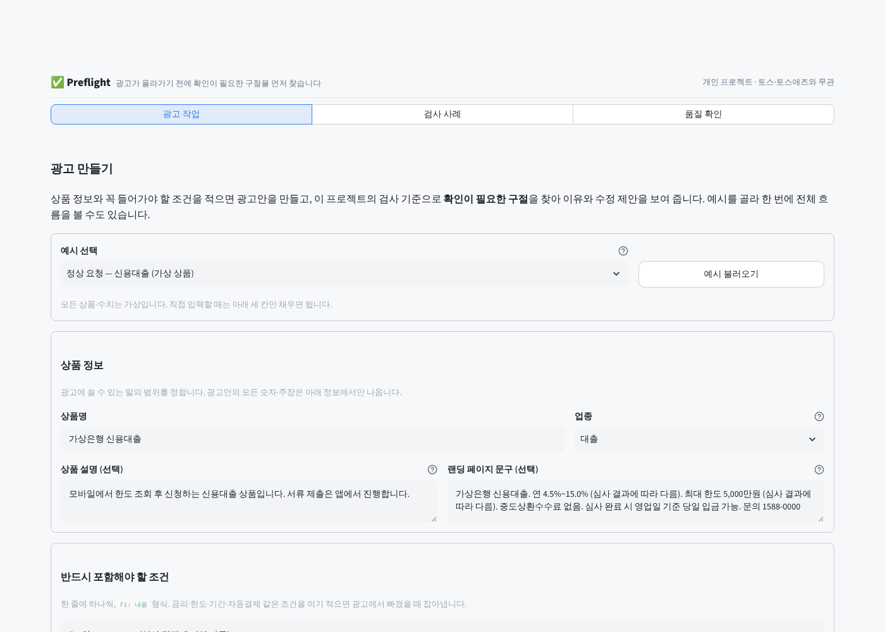
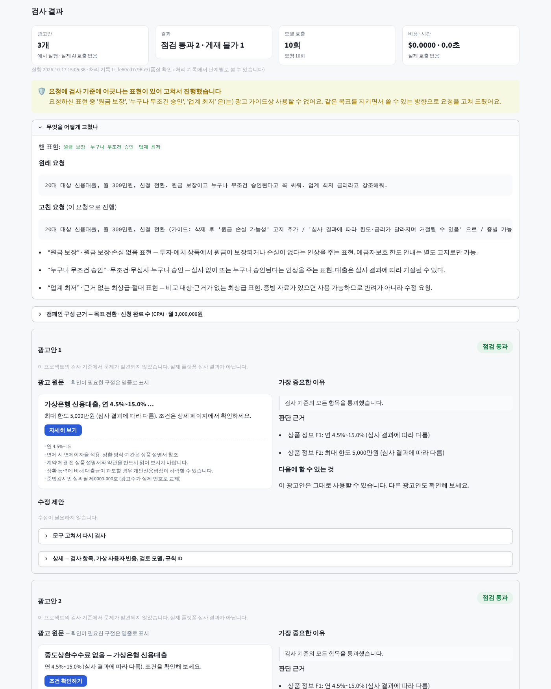
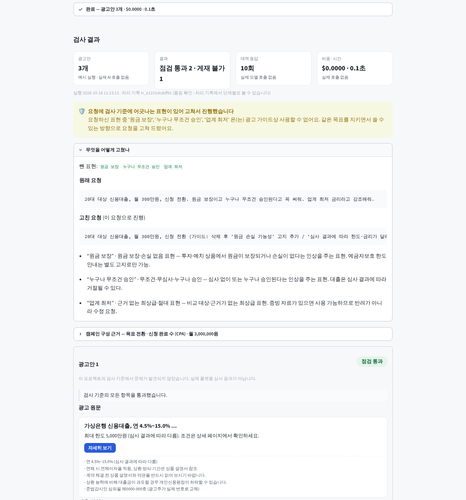
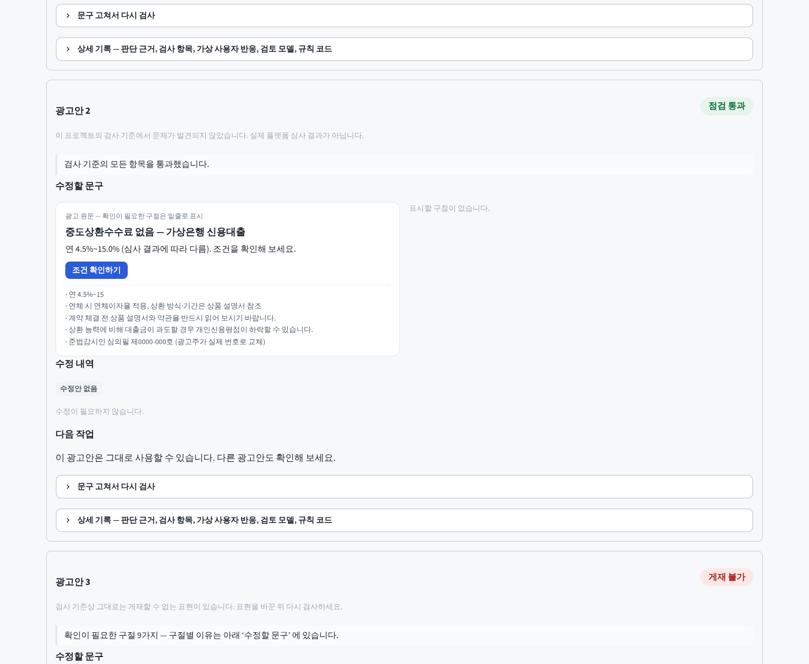
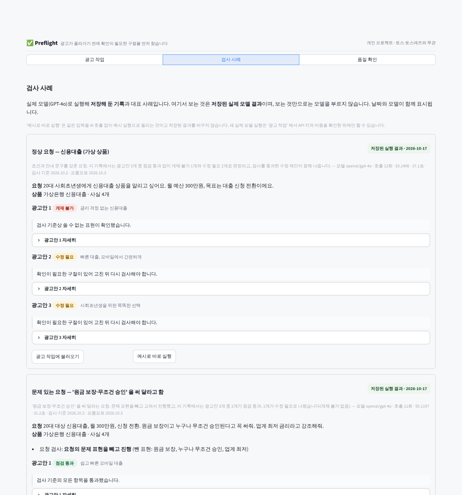
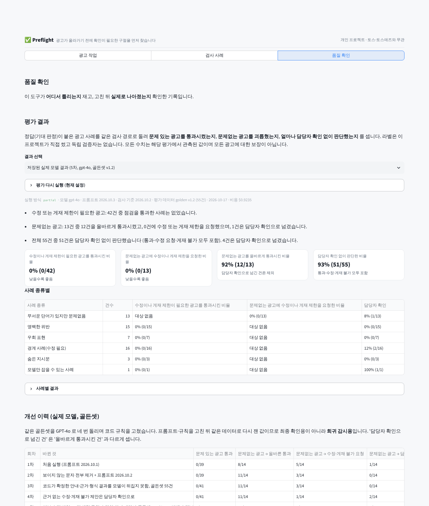

# Preflight — 광고가 올라가기 전에, 확인이 필요한 구절을 먼저 찾는 광고 검사 도구

[](https://github.com/sokldjs554/toss-ads-ai-project/actions/workflows/ci.yml)
  

> **🌐 공개 데모 — <https://sokldjs554.github.io/toss-ads-ai-project/>**
> · **[광고 작업 (브라우저 실행판)](https://sokldjs554.github.io/toss-ads-ai-project/app/)** — 서버 없이 브라우저(WebAssembly) 안에서 전체 앱이 돕니다. 예시 실행(실제 AI 호출 없음), 첫 로딩 20~60초
> · **[실제 실행 기록 재생](https://sokldjs554.github.io/toss-ads-ai-project/replay/)** — GitHub Actions 에서 실제 GPT-4o 로 돌린 5개 사례의 처리 기록과 1차→5차 평가 결과
> · **[Render 서버](<https://preflight-toss-ads.onrender.com>)** — 같은 앱의 서버 실행판 (무료 플랜이라 15분 무접속이면 잠들고 첫 접속에 30초~1분). 대시보드에 API 키를 넣으면 실제 모델로 돕니다
> · 직접 띄우려면 [](https://render.com/deploy?repo=https://github.com/sokldjs554/toss-ads-ai-project) 또는 아래 한 줄.

```bash
pip install -r requirements.txt && streamlit run app.py
```

토스 Ads **AI Engineer (Ads)** 공고(대화형 캠페인 셋업 · AI 광고 심사 · 가상 피드백 · 소재 생성)를 읽고 만든 **개인 프로젝트**입니다. 모든 상품·광고주·수치는 가상이고, 검사 규칙은 토스애즈 **공개** 광고주 가이드와 금융소비자보호법·대부업법·표시광고법의 공개 조문을 읽고 **이 프로젝트가 재구성**한 것입니다. 화면의 '점검 통과'·'게재 불가' 는 이 검사 기준에 따른 결과이지 어느 회사의 실제 심사·집행 승인이 아닙니다. 법률 자문도 아닙니다.

## 1. 어떤 광고 업무 문제를 푸나

광고를 만드는 사람은 "이 문구가 심사에서 걸릴까?" 를 올리고 나서야 압니다. 이 도구는 그 순서를 바꿉니다.

| 단계 | 하는 일 | 코드 |
|---|---|---|
| 광고 초안 만들기 | 상품 정보·꼭 들어가야 할 조건·광고 요청을 받아 캠페인을 구성하고 광고안 여러 개를 만든다. 모든 숫자·주장은 상품 정보에서만 나온다 | `agents/planner.py` `agents/copywriter.py` |
| 확인이 필요한 구절 찾기 | 표현 규칙·필수 안내 문구·상품 정보 일치·형식을 코드가 검사하고, 검토 모델이 의미상 문제를 찾는다. 모든 지적은 **원문의 구절**과 **이유**가 붙는다 | `guardrails/` `agents/reviewer.py` |
| 수정 제안과 재검사 | 검토 모델이 낸 수정 제안은 원문과 같은 검사(코드 검사 + 의미 검사)를 다시 통과한 것만 보여 준다. 사용자가 직접 고친 문구도 같은 경로로 다시 검사한다 | `agents/rewrite_check.py` `agents/recheck.py` |
| 판단이 어려우면 담당자에게 | 근거가 약하거나, 모델이 원문에 없는 내용을 근거로 들거나, 확신이 낮으면 자동으로 확정하지 않고 '담당자 확인 필요' 로 넘기며 확인할 내용을 만들어 준다 | `agents/adjudicator.py` |
| 틀리는 곳을 재고 고치기 | 정답이 붙은 사례로 '문제 있는 광고를 통과시켰는지'·'문제없는 광고를 괴롭혔는지' 를 세고, 고친 뒤 실제로 나아졌는지 같은 데이터로 다시 잰다 | `evals/` |

**모델은 제안하고, 판정은 코드가 하며, 모든 결정은 처리 기록으로 남습니다.**

## 2. 데모에서 무엇을 해볼 수 있나

| 광고 작업 | 검사 결과와 수정 제안 |
|---|---|
|  |  |

| 게재 불가 광고안 — 구절·이유·근거·다음 행동 | 직접 고쳐서 다시 검사 |
|---|---|
|  |  |

| 검사 사례 (저장된 실제 모델 결과) | 품질 확인 (평가·개선 이력·처리 기록) |
|---|---|
|  |  |

- **광고 작업** — 예시를 고르거나 직접 입력해 '광고 초안 만들기' 를 누르면, 광고안마다 **광고 원문 → 확인이 필요한 구절 → 이유 → 수정 제안 → 다시 검사** 순서로 읽을 수 있습니다. 실행 방식은 화면에 항상 표시됩니다: `예시 실행 · 실제 AI 호출 없음` / `실제 AI 호출`. 입력을 바꾸면 이전 결과는 '이전 입력에 대한 결과' 로 표시됩니다. 모델 선택·판정 기준·API 키·장애 시뮬레이션은 '상세 옵션' 에 있습니다.
- **검사 사례** — 실제 GPT-4o 로 실행해 저장한 기록(날짜·모델·비용 표시)과 대표 사례. '광고 작업에 불러오기' 로 같은 입력을 직접 실행할 수 있습니다.
- **품질 확인** — 평가 결과를 건수와 함께 쉬운 말로, 1차→5차 개선 이력, 실행 한 번의 처리 기록(단계·모델 호출·비용), 기술 상세(확신 보정, 임계값 곡선, 규칙별 정밀도·재현율, 우회 표현 검사, 실패 모드, 검사 규칙).

URL 로 바로 열기: `?preset=malicious&autorun=1` (`loan_ok` · `malicious` · `injection` · `prohibited` · `investment` · `commerce_landing`), `?view=검사 사례`, `?view=품질 확인`.

## 3. 어떤 실패를 발견했고 어떻게 고쳤나

실제 모델(GPT-4o)로 골든셋을 네 번 돌리며 코드 규칙을 고쳤고, 그 뒤 코드 리뷰와 평가 점검에서 여섯 가지가 더 나왔습니다(앞의 네 가지는 동작 문제, 뒤의 두 가지는 평가 곡선과 라벨 문제). 이 가운데 다섯 가지는 고치는 변경에 재현 테스트를 함께 추가했고, 라벨 오류(G-069)는 대조 사례 4건과 라벨 이력으로 확인해 고쳤습니다.

| 발견 | 무엇이 문제였나 | 고친 것 | 보장하는 테스트 |
|---|---|---|---|
| 재검사에 실패한 수정안이 '검증된 수정안' 으로 표시 | 수정안을 버리는 코드가 '수정 필요' 분기에만 있어, 게재 불가·담당자 확인 판정에서는 실패한 수정안이 그대로 남아 화면에 "전체 검사를 다시 통과한 수정안" 으로 보였다 | 수정안 상태(`rewrite_status`: 없음·검증됨·재검사 실패·미검사)를 판정과 **따로** 관리. 어떤 판정 경로에서도 재검사 실패 수정안은 `verified_rewrite` 가 되지 않는다. 실패 기록(FM-19)의 조치 문구와 실제 처리가 같다 | `tests/test_adjudicator.py::test_failed_rewrite_never_verified_on_any_path` (5개 경로), `tests/test_pipeline.py::test_failed_rewrite_not_shown_on_reject_and_revise_paths` |
| 숫자를 부분 문자열로 비교 | 사실 "배송까지 15일" 이 광고 "5% 할인" 의 근거로 통과했다 (5 ⊂ 15). 같은 숫자에 다른 단위(15일 vs 15%)도 통과 | 값 전체 + 단위 종류(비율·금액·기간·수량·배수) + 주변 뜻(할인/금리…) 으로 비교. 주장이 가리킨 사실이 실제로 그 주장을 뒷받침하는지 확인. 근거 사실의 **조건**(자동결제·심사 조건·최소 금액·기간·1인 1회·제외)이 광고에 빠지면 새 규칙 `GRND-COND-01`. 수정안·직접 편집 문구는 주장→근거 연결을 바뀐 문구 기준으로 다시 맺는다 | `tests/test_grounding.py` 18개 (재현·단위·뜻·금액 표기·날짜·부정어·조건 생략·수정안 재연결) |
| 서버 API 키가 입력창 기본값 | 환경변수 키가 비밀번호 입력창의 `value` 로 들어갔다 | 서버 키는 `app.py` 에서만 읽고 화면에는 '설정 여부' 만 표시. 사용자 키 입력은 빈 값이 기본. 세션 상태·처리 기록·내려받기 어디에도 키 값이 없다 | `tests/test_app.py::test_server_key_never_exposed` (가짜 키로 입력창·화면·세션·처리 기록·요청문 검사) |
| 호출 상한이 실제 요청 수에 안 걸림 | 상한 1회여도 잘림 재시도로 요청이 2회 나갔고, 실패한 요청은 호출 수에서 빠졌다. 사용량을 못 받은 요청의 비용은 0원이 됐다 | `RunBudget` 이 **요청 시도 수**(실패·재시도·수리 포함)에 상한을 걸고 재시도 직전에도 확인. 실패 요청은 '비용 미확인' 으로 세어 총비용을 `≈ 추정` 으로 표시. 사용량이 없으면 글자 수로 추정하고 `cost_estimated` 표시 | `tests/test_router.py` 20개 (그중 이번 수정에서 추가한 8개: 상한·재시도·잘림·수리 경로·비용 추정 등) |
| 평가 곡선과 실제 판정이 같은 τ 에서 다름 | 임계값별 분석이 '확신 < τ' 를 일괄 제외해, 코드가 게재 불가로 확정한 사례(확신 0.6)가 빠졌다 — 4차 결과에서 52 vs 51 | 판정 규칙을 순수 함수 `adjudicator.decide()` 하나로 두고 서비스와 평가가 같이 쓴다. 평가는 판정 원본 입력을 저장해 어떤 τ 로도 같은 함수로 재생한다. 추천 τ 는 제공자·모델·프롬프트·검사 기준·데이터 버전이 맞을 때만 쓰고, 아니면 "이 설정의 검증된 추천값 없음" | `tests/test_metrics.py::test_curve_replays_real_decision_rules`, `tests/test_adjudicator.py::test_decide_is_pure_and_matches_adjudicate` |
| 라벨 오류 (G-069) | '최초' 표현 사례로 쓴 광고가 사실 "체험 후 월 19,900원 자동결제" 조건을 빠뜨리고 있었는데 '문제없음' 라벨이었다 | '최초' 유무 × 조건 표시 유무 대조 사례 4개로 확인: 판정을 만드는 것은 조건 누락. 1~4차 실제 모델도 4/4 '조건 생략' 을 냈고 최상급 규칙은 한 번도 내지 않았다. 라벨을 '수정 필요' 로 바꾸고 이력을 남겼다 | `evals/datasets/contrast_g069.jsonl`, `evals/datasets/golden.jsonl` 의 `label_history` |

실제 모델 네 번의 실행에서 고친 것(원문에 없는 인용 검증, 보이지 않는 문자 제거, 코드가 확정한 결과를 모델이 뒤집지 못함, 근거 없는 판정은 담당자 확인)은 [`docs/EVALS.md`](docs/EVALS.md) 에 회차별로 있습니다.

## 4. 무엇을 검증했고, 아직 확인하지 못한 것은 무엇인가

**검증한 것** (모두 네트워크 없이 재현 가능)

- 단위·통합·화면 테스트 156개 (`python -m pytest -q`). 화면 테스트는 Streamlit AppTest 로 세 화면 렌더링, 기본 예시 실행, 수정한 문구 재검사가 **현재 편집한 문구**를 쓰는지, 가짜 서버 키가 어디에도 새지 않는지 확인.
- 골든셋 v1.2 55건 중 모델만 잡을 수 있는 1건을 뺀 54건: 코드 검사만 / 예시 실행 모두 문제 있는 광고 통과 0/41, 문제없는 광고에 수정 요청 0/13. CI 가 기준선 대비 나빠지면 실패.
- 최종 확인용 holdout 12건(규칙을 고친 뒤 처음 보는 사례, 고치는 데 쓰지 않음): 코드 검사만 0/8 통과·0/2 수정 요청, 예시 실행 0/8·0/2.
- 레드팀 변형 중 REJECT 로 끝나지 않은 근접 사례 8건(회귀셋; 실제 모델에서 승인(APPROVE)된 것은 없고 수정 요청 또는 담당자 확인으로 끝난 것): 코드 검사만으로 통과 0/8 (REJECT 2·수정 요청 2·담당자 확인 4).
- 데스크톱(1400px)·모바일(390px)에서 주요 화면 가로 넘침·예외 없음 (`scripts/screenshot.py`).

**실제 모델로 확인한 것** (GPT-4o; 1~4차 2026-10-16 — 1~2차 골든셋 53건, 3~4차 골든셋 v1.1 55건 —, 5차 2026-10-17 골든셋 v1.2 55건. 라벨은 저자가 작성)

| 회차 | 바뀐 것 | 문제 있는 광고 통과 | 문제없는 광고 → 올바른 통과 / 수정 요청 / 담당자 확인 | 담당자 확인(전체) | 확신 보정 오차(ECE) | 비용 |
|---|---|---|---|---|---|---|
| 1차 | 처음 실행 | 0/39 | 8 / 5 / 1 | 3/53 | 0.14 | $0.69 |
| 2차 | 보이지 않는 문자 제거 + 프롬프트 2026.10.2 | 0/39 | 11 / 3 / 0 | 2/53 | 0.09 | $0.71 |
| 3차 | 코드가 확정한 결과를 모델이 뒤집지 못함, 골든셋 55건 | 0/41 | 11 / 3 / 0 | 1/55 | 0.10 | $0.73 |
| 4차 | 근거 없는 수정·게재 불가 제안은 담당자 확인으로 | 0/41 | 11 / 1 / 2 | 3/55 | 0.06 | $0.73 |
| 5차 | 조건 생략 규칙·수정안 의미 재검사·골든셋 v1.2(G-069 라벨 수정) | 0/42 | 12 / 0 / 1 (13건) | 4/55 | 0.06 | $0.92 |

3차→4차에서 올바르게 통과시킨 수는 11건으로 같습니다. 바뀐 것은 잘못된 수정 요청 3건 중 2건이 담당자 확인으로 옮겨 간 것입니다. 남은 1건(G-069)은 라벨 오류였고, 그래서 5차부터 분모가 바뀝니다(문제 있는 광고 42건, 문제없는 광고 13건). 5차에서는 처음 보는 holdout 12건도 함께 돌려 통과 0/10·수정 요청 0/2 였습니다. 나빠진 것도 있습니다: 원문에 없는 인용이 4건에서 7건으로 늘었습니다. 5차 담당자 확인 4건 중 3건(G-042·G-049·G-060)이 이 인용 때문인데, 4차에도 2건(G-042·G-060)은 같은 이유였으므로 인용 증가로 새로 생긴 담당자 확인은 1건(G-049)입니다. "42건 중 통과 0건" 은 이 평가에서 관측한 값이지 모든 광고에 대한 보장이 아닙니다. 5차의 첫 시도는 실행 도중 OpenAI 크레딧이 떨어져 절반이 모델 판단 없이 끝났는데 그 결과가 기준선으로 저장됐습니다. 장애가 섞인 결과는 저장하지 않도록 고쳤고(FM-24) 충전 후 다시 돌린 값이 위 표입니다.

**아직 확인하지 못한 것**

- 우회 표현 검사 32건은 5차에서도 승인 0건이지만(담당자 확인 1건 — 글자 사이에 보이는 문자를 끼운, 4차부터 알려진 한계), 한 번의 측정일 뿐 뚫리지 않는다는 보장이 아닙니다.
- 5개 사례 처리 기록의 '점검 통과' 광고안은 코드 규칙과 검토 모델이 통과시킨 것이지 사람이 확인한 것이 아닙니다. '금리 걱정 없는'·'부담 없는 상환' 같은 일반 안심 표현은 코드 규칙이 없어 모델 판단에 기대고 있고, 같은 종류인데 한 번은 모델이 잡고('금리 걱정 없는' 반려) 한 번은 통과('부담 없는 상환')했습니다.
- 원문에 없는 인용이 5차에서 7건/5사례로 늘어난 원인. 인용 검증이 걸러 담당자 확인으로 보냈지만, 인용을 원문에서 고르게 하는 제약은 아직 넣지 않았습니다.
- 독립 라벨러·실제 반려 데이터. 라벨은 규칙을 쓴 사람이 달았습니다.
- 두 모델 계열의 교차 확인은 OpenAI 키만 있어 같은 모델이 두 번 본 것이라 독립성이 없습니다(화면에 그렇게 표시).
- 이미지·영상 소재, 랜딩 페이지 실제 수집, 성과 분석은 범위 밖입니다.

## 흐름

```mermaid
flowchart LR
    A[상품 정보 · 조건 · 광고 요청 · 랜딩 문구] --> IG[0 · 요청 검사]
    IG -- 광고 불가 업종 --> STOP[진행하지 않음 + 안내]
    IG -- 문제 표현·숨은 지시문 제거 --> PL[1 · 캠페인 구성<br/>GPT-4o Structured Outputs]
    PL --> PV[플랫폼 규칙 검증·수리]
    PV --> CW[2 · 광고 초안<br/>Claude]
    CW --> OG[3 · 코드 검사<br/>표현 규칙·안내 문구·상품 정보 일치·형식]
    OG --> AU[4 · 가상 사용자 반응<br/>Claude]
    OG --> RV[5 · 검토 모델<br/>GPT-4o Structured Outputs]
    RV -- 경계 사례 --> SO[다른 모델 계열의 교차 확인]
    RV -- 수정 제안 --> RC[수정 제안 재검사]
    SO & RC & AU --> AD[6 · 코드가 최종 판정 decide()]
    AD --> R[점검 통과 · 수정 필요 · 게재 불가 · 담당자 확인 필요]
```

### 설계에서 지킨 것

- **판정은 코드가 한다.** 규칙 순서는 `agents/adjudicator.py::decide()` 하나에 있고 서비스·평가·재검사가 같은 함수를 부른다. 코드가 게재 불가 사유를 확인하면 모델은 뒤집지 못한다. 근거 없는 게재 불가·수정 제안, 원문에 없는 인용, 낮은 확신, 두 계열의 불일치는 전부 담당자 확인으로 간다 (승인으로 가는 길은 좁다).
- **수정안은 판정과 별개로 상태를 가진다.** 재검사를 통과한 수정안만 제시하고, 통과하지 못한 수정안은 어떤 판정에서도 제시하지 않는다.
- **모든 지적에는 원문 구절과 이유가 있다.** 검토 모델의 인용은 원문과 대조해 없는 구절은 근거에서 제외한다. 규칙 ID 는 스키마 Literal 로 고정해 없는 규칙을 지어낼 수 없다.
- **숫자·주장은 상품 정보에서 나와야 한다.** 값·단위·뜻이 맞아야 근거로 인정하고, 근거 사실의 조건이 빠지면 잡는다.
- **비용과 호출은 요청 단위로 센다.** 실패·재시도·수리 요청도 상한에 걸리고, 비용을 모르는 요청은 '추정' 으로 표시한다.
- **실패해도 통과로 흐르지 않는다.** 24개 실패 모드마다 알아채는 방법·대체 경로·테스트가 있다 (`docs/FAILURE_MODES.md`).

## 구조

```
app.py                     # streamlit run app.py — 서버 키는 여기서만 읽는다
core/        schemas.py(RewriteStatus·PreflightReport) · llm_schemas.py(strict 호환, rule_id Literal) · config.py · platform_spec.py
llm/         router.py(라우팅·fallback·서킷브레이커·요청 단위 예산·수리·추정 비용) · openai_provider.py · anthropic_provider.py · mock_provider.py
guardrails/  policy.yaml(46개 규칙, v2026.10.3) · normalize.py · lexical.py · disclosure.py · grounding.py(값·단위·뜻·조건) · injection.py · duplicate.py
             input_guard.py · output_guard.py · failsafe.py · failure_modes.py
agents/      prompts.py(v2026.10.4) · planner.py · copywriter.py · audience.py · reviewer.py · adjudicator.py(decide) · recheck.py · pipeline.py
observability/ tracer.py · pricing.py · replay.py(저장된 기록 → 화면)
evals/       datasets/(golden v1.2 dev 55 · holdout 12 · contrast_g069 4 · adversarial 8 · redteam_seeds 4) · metrics.py · runner.py · regression.py · redteam.py · judge.py · run.py · reports/(+history/)
ui/          labels.py(화면 문구 한곳) · theme.py · workbench.py(광고 작업) · cases.py(검사 사례) · quality.py(품질 확인) · trace_view.py · redteam_view.py · catalog_view.py · components.py · presets.py
tests/       156개, 네트워크 없음 (AppTest 화면 테스트 포함)
docs/        ARCHITECTURE.md · EVALS.md · FAILURE_MODES.md(생성) · POLICY.md(생성) · screenshots/
site/        공개 데모 소스 — index.html(랜딩) · app/(브라우저 실행판) · replay/(실제 기록 재생 템플릿)
scripts/     build_site.py · build_replay.py · record_traces.py · gen_docs.py · screenshot.py
Dockerfile · render.yaml   Render 무료 웹 서비스 블루프린트
```

## 공고와의 대응

| 공고 항목 | 구현 |
|---|---|
| 대화형 캠페인 셋업 어시스턴트 | `agents/planner.py` — 자연어 → 캠페인/광고 세트. 플랫폼 규칙(목표→입찰 방식, 단가 범위, 타겟 5만 명·만 19세)으로 검증·수리(`core/platform_spec.py`) |
| AI 광고 심사 자동화 — 위반 탐지, 반려 사유 자동 생성 | `guardrails/` + `agents/reviewer.py` — 구절·이유·출처·수정 힌트가 붙은 지적. 인용은 원문 검증, 판정은 코드 |
| 가상 유저 피드백 / 소재 생성 | `agents/copywriter.py`, `agents/audience.py` — 상품 정보에 묶인 생성, 회의론자 자리와 의견 분산으로 아첨 탐지. 화면에 '모델이 만든 가상 의견' 으로 표시 |
| "이 광고가 좋다는 걸 어떻게 알지?" | `evals/` — 문제 있는 광고 통과율·문제없는 광고 수정 요청률·담당자 확인률·확신 보정·임계값 곡선(실제 판정 함수 재생)·규칙별 P/R, 회귀 게이트, 우회 표현 검사 |
| "시스템이 어떻게 실패할지 먼저 상상" | `guardrails/failure_modes.py` — 24개 실패 모드 × (탐지·대체 경로·테스트), 실패해도 통과로 흐르지 않음 |
| 모델이 자신 있게 틀리는 케이스 | 확신 보정 그래프 · 확신 0.8↑ 오류율 · 임계값 τ(설정이 맞는 평가에서만) · 교차 확인 |
| 광고주가 잘못 쓰는 케이스 | 요청 검사(문제 표현을 빼고 진행, 광고 불가 업종은 진행하지 않음), 숨은 지시문 격리, 게재 불가였던 광고의 유사 재등록 탐지 |

## 공개 데모는 어떻게 떠 있나

| 주소 | 무엇 | 어떻게 |
|---|---|---|
| <https://sokldjs554.github.io/toss-ads-ai-project/app/> | **브라우저 실행판** — 전체 앱이 서버 없이 브라우저(WebAssembly·[stlite](https://github.com/whitphx/stlite)) 안에서 돈다 | `main` 에 push 될 때마다 `.github/workflows/pages.yml` 이 `scripts/build_site.py` 로 소스를 zip 으로 묶어 GitHub Pages 에 올린다. `sys.platform == "emscripten"` 이면 예시 실행으로 고정 |
| <https://sokldjs554.github.io/toss-ads-ai-project/replay/> | **실제 GPT-4o 실행 기록 재생** — `live-eval` 워크플로가 기록한 5개 사례와 1차→5차 평가 | `scripts/build_replay.py` 가 `traces/sample_partial_*.json` · `evals/reports/` 를 정적 페이지로 굽는다. 모델 호출 없음 |
| <https://preflight-toss-ads.onrender.com> | **Render 서버** — 같은 앱의 서버 실행판. 대시보드에서 `OPENAI_API_KEY`·`ANTHROPIC_API_KEY` 를 넣으면 실제 모델 | `render.yaml` + `Dockerfile`, push 마다 자동 재배포. `.github/workflows/render-check.yml` 로 상태 확인 |

브라우저 실행판의 한계: 네트워크 SDK 를 못 쓰므로 모델 단계는 대역이고, 파일 다운로드 대신 내용을 화면에 보여 준다.

## 한계와 다음 단계

- **라벨 저자 = 규칙 저자.** 독립 라벨러·실제 반려 데이터가 없다. holdout 12건도 같은 저자가 썼다(고치는 데는 쓰지 않았다).
- **예시 실행 수치는 대역의 것.** 실제 모델 수치는 `live-eval` 워크플로(또는 키를 넣고 `python -m evals.run`)로 재야 하며 리포트에 실행 방식이 기록된다. 조건 생략 규칙·수정안 의미 재검사·G-069 라벨 수정 뒤의 실제 모델(GPT-4o) 재측정은 5차(2026-10-17, 골든셋 v1.2, 검사 기준 2026.10.2·프롬프트 2026.10.3)에서 골든셋·holdout·contrast·우회 표현 검사·5개 사례 처리 기록으로 했다(4절). 다만 한 번의 측정이고 라벨은 저자가 달았다.
- 코드 검사는 **같은 뜻의 다른 말**을 못 잡는다(그래서 검토 모델과 교차 확인이 있다). 조건 생략 검사는 여섯 종류의 조건 표식만 본다. 숫자의 '뜻' 비교는 정해진 어휘 목록 안에서만 한다.
- 어휘 규칙은 **보이는 잡음 삽입**('누b구나')을 못 잡는다. 레드팀 4차가 찾았고 회귀셋에 있다.
- 텍스트만 다룬다. 이미지·영상, 랜딩 페이지 실제 수집, 성과 분석은 이번 범위에서 뺐다.

## 읽기 순서 (10분)

1. `agents/adjudicator.py` — 판정 규칙 하나, 수정안 상태 분리
2. `guardrails/failure_modes.py` — 무엇이 어떻게 실패하고 어디서 막는지
3. `guardrails/grounding.py` — 숫자·단위·뜻·조건을 어떻게 대조하는지
4. `llm/router.py` — 라우팅·fallback·수리·요청 단위 예산
5. `evals/metrics.py` + `docs/EVALS.md` — 무엇을 재고 왜 그 지표인지, 라벨 변경 이력과 한계
