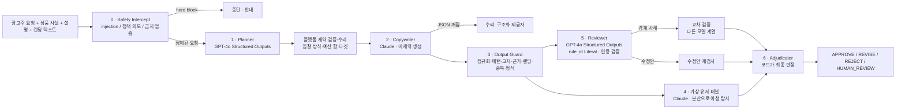

# 아키텍처

## 한 문장

**모델은 제안하고, 코드가 판정하고, 트레이스가 증명한다.** LLM 출력은 신뢰하지 않는 입력(untrusted input)으로 다루고, 승인으로 가는 모든 경로에는 코드가 검증하는 관문이 있다.

## 흐름

모든 상자는 트레이스 스팬이다. 실패하면 예외가 밖으로 나가지 않고 `FailureEvent(FM-xx)` 로 기록된 뒤 정해진 대체 경로를 탄다.

## 디렉터리

| 경로 | 역할 |
|---|---|
| `core/` | 도메인 스키마(`schemas.py`), LLM 출력 스키마(`llm_schemas.py` — strict 호환, rule_id Literal), 설정, 플랫폼 제약(`platform_spec.py`) |
| `llm/` | 제공자 추상화. `router.py` 가 작업→제공자 라우팅, fallback 체인, 서킷브레이커, 예산 상한, 수리 경로, 장애 시뮬레이션을 맡는다 |
| `guardrails/` | 정책 카탈로그(`policy.yaml`), 정규화(`normalize.py`), 결정론 규칙(`lexical.py`), 고지(`disclosure.py`), 근거·랜딩(`grounding.py`), 인젝션(`injection.py`), 중복(`duplicate.py`), 입력 인터셉트(`input_guard.py`), 출력 묶음(`output_guard.py`), 실패 분류(`failsafe.py`, `failure_modes.py`) |
| `agents/` | 단계별 에이전트(planner, copywriter, audience, reviewer, adjudicator)와 `pipeline.py`. 프롬프트는 `prompts.py` 한 곳에 버전과 함께 |
| `observability/` | 의존성 없는 트레이서(`tracer.py`: Trace/Span, contextvars, JSON 직렬화)와 가격표 |
| `evals/` | 데이터셋, 지표, 실행기, 회귀 게이트, 레드팀, 쌍대 판정자, CLI |
| `ui/` | Streamlit 화면. 계산은 하지 않는다 |
| `tests/` | 85개 단위·통합 테스트 (네트워크 없음) |
| `traces/` | 재생용 샘플 트레이스 |

## 하이브리드 라우팅

| 작업 | 1순위 | fallback | 이유 |
|---|---|---|---|
| 캠페인 계획(PLAN) | OpenAI · `chat.completions.parse` | Anthropic · `messages.parse` | 스키마 보장이 중요. 값 수준(예산 합·입찰 허용)은 코드가 다시 검증 |
| 심사(REVIEW) · 품질 판정(JUDGE) · 수리(REPAIR) | OpenAI 구조화 | Anthropic 구조화 | `rule_id` 를 카탈로그 Literal 로 고정 → 없는 규칙을 생성할 수 없음 |
| 소재(COPY) · 패널(AUDIENCE) · 준수 제안(REDIRECT) · 레드팀(ATTACK) | Anthropic · 비제약 | OpenAI 구조화 | 창의 작업은 형식 제약 없이 돌리고(형식 제약이 품질을 떨어뜨린다는 보고), 형식이 어긋나면 구조화 제공자가 '텍스트→스키마' 수리 |
| 교차 검증(SECOND_OPINION) | Anthropic 구조화 | OpenAI | 같은 계열의 상관 오류를 피하려고 **다른** 계열에 묻는다 |

- 제공자 실패(타임아웃·429·5xx)는 서킷브레이커(연속 3회 → 60초 open)에 기록되고 다음 제공자로 넘어간다.
- 거부(refusal)·잘림(max_tokens)·스키마 불일치는 각각 타입이 있는 예외라 라우터가 다르게 처리한다 (잘림은 max_tokens 2배 재시도 1회).
- 실행 단위 예산 상한(기본 $0.50)·호출 횟수 상한을 넘으면 `BudgetExceeded` 로 즉시 중단, 남은 소재는 사람 검토.
- 키가 없으면 결정론 대역(`mock_provider.py`)이 LLM 자리를 맡는다. 대역은 일부러 '공격적인' 변형을 섞어 가드레일이 잡는 모습을 보여 준다. 모든 결과에 `provider=mock` 이 찍힌다.

## 가드레일 계층 (앞일수록 싸고 결정론적)

| 계층 | 하는 일 | 못 하는 일 |
|---|---|---|
| injection | 지시문·역할 전환·심사 조작 패턴(한/영), 숨은 문자. 문장 제거 + `<untrusted_data>` 포장 | 자연어로 교묘히 쓴 설득은 못 잡는다 → semantic |
| lexical | NFKC·제로폭·한자 접기·띄어쓰기 분해 후 두 표면(loose/tight)에서 패턴. 예외 창, 부정문 강등, 우회 흔적 시 심각도 상향 | 같은 뜻의 다른 말('손해 볼 일 없는')은 어휘로 못 잡는다 → semantic |
| disclosure | 업종별 필수 고지 체크리스트, 고지란의 광고 문구 | 고지 내용의 사실 여부 |
| grounding | 소재의 숫자·주장이 사실 목록/랜딩에 있는지, `fact_id` 유효성, 랜딩 어휘 겹침 | 사실 목록 자체의 진위 |
| structural | 길이·한글 비율·중복 재등록·플랫폼 제약 | — |
| semantic | LLM 심사. 결정론 finding 은 '확정 사실' 로 주고, 놓친 의미상 위반만 찾게 한다. 인용은 원문 대조, rule_id 는 스키마로 고정 | 모델이 틀릴 수 있다 → 신뢰도 임계값·교차 검증·사람 검토 |

## 판정 규칙 (adjudicator)

1. 결정론 **block** 이 하나라도 있으면 REJECT — 모델은 뒤집지 못한다.
2. 심사 모델이 실패했으면 HUMAN_REVIEW.
3. 모델이 REJECT 라 했지만 **검증된** block 인용이 없으면 HUMAN_REVIEW (증거 없는 반려는 자동화하지 않는다).
4. 환각 인용이 있으면 HUMAN_REVIEW, 신뢰도 < τ 면 HUMAN_REVIEW, 두 계열의 판정이 다르면 HUMAN_REVIEW.
5. fix 가 있으면 REVISE — 자동 수정안은 전체 가드레일을 다시 통과한 것만 붙인다. 통과 못 하면 수정안을 폐기한다.
6. 그 외 APPROVE.

τ(자동 판정 최소 신뢰도) 는 평가 탭의 커버리지 곡선으로 정한다: "위험 승인 0% 를 유지하면서 가장 많이 자동 처리하는 τ".

## 트레이스 모델

`Trace(name, trace_id, metadata, root: Span)` · `Span(name, kind ∈ {stage, llm, guardrail, tool}, status ∈ {ok, error, intercepted, fallback}, attributes, events, children)`.
LLM 스팬 속성: provider, model, 시도 체인, 제약 디코딩 여부, 토큰, 비용, 지연, 수리 여부, 프롬프트/응답 원문. 가드레일 스팬 속성: finding 목록, 체크리스트.
JSON 으로 내보내고 다시 읽어 '재생' 할 수 있다 — 관측 탭의 `traces/sample_*.json`.

## 왜 Streamlit 하나에 다 넣었나

면접관이 `pip install -r requirements.txt && streamlit run app.py` 한 줄로 에이전트의 움직임·가드레일·트레이스·평가를 전부 볼 수 있어야 한다는 요구 때문이다. 계산 코드는 UI 와 분리되어 있어(`ui/` 는 그리기만 한다) FastAPI 등으로 옮기는 데 UI 코드 변경이 필요 없다.
