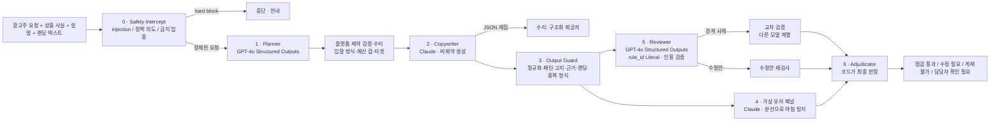

# 아키텍처

## 한 문장

**모델은 제안하고, 코드가 판정하고, 트레이스가 증명한다.** LLM 출력은 신뢰하지 않는 입력(untrusted input)으로 다루고, 승인으로 가는 모든 경로에는 코드가 검증하는 관문이 있다.

## 흐름

모든 상자는 트레이스 스팬이다. 실패하면 예외가 밖으로 나가지 않고 `FailureEvent(FM-xx)` 로 기록된 뒤 정해진 대체 경로를 탄다.

## 디렉터리

| 경로 | 역할 |
|---|---|
| `core/` | 도메인 스키마(`schemas.py`), LLM 출력 스키마(`llm_schemas.py` — strict 호환, rule_id Literal), 설정, 플랫폼 제약(`platform_spec.py`) |
| `llm/` | 제공자 추상화. `router.py` 가 작업→제공자 라우팅, fallback 체인, 서킷브레이커, 예산 상한, 수리 경로, 장애 시뮬레이션을 맡는다 |
| `guardrails/` | 정책 카탈로그(`policy.yaml`), 정규화(`normalize.py`), 결정론 규칙(`lexical.py`), 고지(`disclosure.py`), 근거·랜딩(`grounding.py`), 인젝션(`injection.py`), 중복(`duplicate.py`), 입력 인터셉트(`input_guard.py`), 출력 묶음(`output_guard.py`), 실패 분류(`failsafe.py`, `failure_modes.py`) |
| `agents/` | 단계별 에이전트(planner, copywriter, audience, reviewer, adjudicator)와 `pipeline.py`, 자동 수정안의 재검사 `rewrite_check.py`, 직접 고친 문구의 재검사와 재사용 키·시도 기록 `recheck.py`. 프롬프트는 `prompts.py` 한 곳에 버전과 함께 |
| `observability/` | 의존성 없는 트레이서(`tracer.py`: Trace/Span, contextvars, JSON 직렬화), 가격표, 저장된 기록을 화면용으로 되살리는 `replay.py` |
| `evals/` | 데이터셋(golden dev · holdout · contrast · conditions · adversarial, 출처는 `PROVENANCE.json`), 지표, 실행기(판정 원본 입력 저장·추천 τ 유효성·재시도 기록), 방식 비교(`compare.py`), 회귀 게이트, 레드팀, 쌍대 판정자, CLI |
| `ui/` | Streamlit 화면 세 영역 — `workbench.py`(광고 작업) · `cases.py`(검사 사례) · `quality.py`(품질 확인, 방식 비교는 `compare_view.py`). 화면 문구는 `labels.py` 한 곳, 디자인 토큰은 `theme.py`. 계산·판정은 하지 않는다 |
| `tests/` | 1661개 단위·통합·화면(AppTest) 테스트 (네트워크 없음) |
| `scripts/` | 사이트·재생 페이지 빌드, 처리 기록 저장, 문서 생성, 스크린샷, **`e2e_flow.py`**(브라우저로 데스크톱·모바일에서 예시 실행→재검사→확인 요청→재시도까지 끝까지 누르며 검사) |
| `traces/` | 재생용 샘플 트레이스 |

## 하이브리드 라우팅

| 작업 | 1순위 | fallback | 이유 |
|---|---|---|---|
| 캠페인 계획(PLAN) | OpenAI · `chat.completions.parse` | Anthropic · `messages.parse` | 스키마 보장이 중요. 값 수준(예산 합·입찰 허용)은 코드가 다시 검증 |
| 심사(REVIEW) · 품질 판정(JUDGE) · 수리(REPAIR) | OpenAI 구조화 | Anthropic 구조화 | `rule_id` 를 카탈로그 Literal 로 고정 → 없는 규칙을 생성할 수 없음 |
| 소재(COPY) · 패널(AUDIENCE) · 준수 제안(REDIRECT) · 레드팀(ATTACK) | Anthropic · 비제약 | OpenAI 구조화 | 창의 작업은 형식 제약 없이 돌리고(형식 제약이 품질을 떨어뜨린다는 보고), 형식이 어긋나면 구조화 제공자가 '텍스트→스키마' 수리 |
| 교차 검증(SECOND_OPINION) | Anthropic 구조화 | OpenAI | 같은 계열의 상관 오류를 피하려고 **다른** 계열에 묻는다 |

- 제공자 실패(타임아웃·429·5xx)는 서킷브레이커(연속 3회 → 60초 open)에 기록되고 다음 제공자로 넘어간다.
- 거부(refusal)·잘림(max_tokens)·스키마 불일치는 각각 타입이 있는 예외라 라우터가 다르게 처리한다 (잘림은 max_tokens 2배 재시도 1회).
- 실행 단위 예산 상한(기본 $0.50)·호출 횟수 상한은 **요청 시도 수**(실패·재시도·수리 포함)에 걸리고 재시도 직전에도 확인한다. 넘으면 `BudgetExceeded` 로 즉시 중단. 검사하지 못한 소재는 코드 검사만 붙여 담당자 확인으로 남기고(코드 검사에서 block 이 확인되면 게재 불가 유지 + 모델 검사 미수행 표기), 결과에서 사라지지 않는다. 응답을 못 받은 요청은 비용 미확인으로 세어 총비용을 '추정' 으로 표시하고, 제공자가 사용량을 주지 않으면 글자 수로 추정해 `cost_estimated` 를 붙인다.
- 키가 없으면 결정론 대역(`mock_provider.py`)이 LLM 자리를 맡는다. 대역은 일부러 '공격적인' 변형을 섞어 가드레일이 잡는 모습을 보여 준다. 모든 결과에 `provider=mock` 이 찍힌다.

## 가드레일 계층 (앞일수록 싸고 결정론적)

| 계층 | 하는 일 | 못 하는 일 |
|---|---|---|
| injection | 지시문·역할 전환·심사 조작 패턴(한/영), 숨은 문자. 문장 제거 + `<untrusted_data>` 포장 | 자연어로 교묘히 쓴 설득은 못 잡는다 → semantic |
| lexical | NFKC·제로폭·한자 접기·띄어쓰기 분해 후 두 표면(loose/tight)에서 패턴. 예외 창, 부정문 강등, 우회 흔적 시 심각도 상향 | 같은 뜻의 다른 말('손해 볼 일 없는')은 어휘로 못 잡는다 → semantic |
| disclosure | 업종별 필수 고지 체크리스트, 고지란의 광고 문구 | 고지 내용의 사실 여부 |
| grounding | 소재의 숫자(**안내 문구 포함**, 한글에 붙여 쓴 `할인5%`·전각 `５０％`·구어 `90프로`·범위 `50-60%`/`4.5~15.0%`·복합 금액 `1만5천원` 포함)가 값·단위 종류·주기(월/연, `월 최대`·`연회비` 같은 수식어·복합어 포함)·뜻까지 같은 수치로 사실 목록/랜딩에 있는지(전화·심의번호·사업자번호·URL·버전·기준일은 혜택 수치로 읽지 않음, 날짜는 둘 다 연도를 말했을 때만 연도까지 비교), 주장이 가리킨 `fact_id` 가 존재하고 실제로 그 주장을 뒷받침하는지, 근거 사실의 조건 **여섯 종류**(자동결제·심사 조건·최소 금액·기간·1인 횟수·제외)가 광고에 **같은 값·같은 뜻으로** 있는지 — 빠지면 `GRND-COND-01`, 값이 다르거나 뜻이 반대(있다↔없다, 이상↔이하)면 `GRND-COND-02`, 랜딩 어휘 겹침 | 사실 목록 자체의 진위, 여섯 종류 밖의 조건, 어휘 목록 밖의 '뜻', 날짜 없는 기간 표현('10월 한 달')·한쪽만 말한 주기·목록에 없는 돌려 말하기(부정은 `없어요`·`불필요`·`안 해요`·`아닌`·`미적용`·`NO` 등 정해진 표현만 읽는다) |
| structural | 길이·한글 비율·중복 재등록·플랫폼 제약 | — |
| semantic | LLM 심사. 결정론 finding 은 '확정 사실' 로 주고, 놓친 의미상 위반만 찾게 한다. 인용은 원문 대조, rule_id 는 스키마로 고정 | 모델이 틀릴 수 있다 → 신뢰도 임계값·교차 검증·사람 검토 |

## 판정 규칙 (adjudicator)

규칙 순서는 순수 함수 `agents/adjudicator.py::decide(inputs, τ)` 하나에만 있다. 서비스(pipeline)·직접 수정 재검사(recheck)·평가(evals)가 같은 함수를 부르므로 같은 입력·같은 모델 응답·같은 τ 면 같은 판정이 나온다.

1. 코드 검사에서 **block** 이 하나라도 있으면 게재 불가 — 모델은 뒤집지 못한다 (확신과 무관).
2. 검토 모델이 실패했으면 담당자 확인.
3. 모델이 게재 불가라 했지만 **원문에서 검증된** block 인용이 없으면 담당자 확인.
4. 모델이 게재 불가라 했고 **검증된 block 인용이 있으면 게재 불가** — 3·5~9번보다 먼저 확인하므로 확신·원문에 없는 인용 수·교차 확인과 무관하다.
5. 원문에 없는 인용이 있으면 담당자 확인.
6. 모델이 수정·게재 불가를 말했는데 근거 finding 이 하나도 남지 않았으면 담당자 확인.
7. 확신 < τ 면 담당자 확인.
8. 두 계열의 판정이 다르면 담당자 확인.
9. **교차 확인이 필요한 경계 사례인데 그 호출이 실패했으면 담당자 확인** (일치 여부를 모르므로 통과·수정으로 흐르지 않는다).
10. 모델이 수정 필요라 했거나 코드 fix 가 있으면 수정 필요.
11. 그 외 점검 통과.

**세 경로가 같은 함수를 부른다.** 처음 만든 광고안(`pipeline`), 모델이 낸 자동 수정안(`rewrite_check.check_rewrite` → `RewriteCheck.judge` → `decide`), 사용자가 직접 고친 문구(`recheck`)가 모두 `decide(τ)` 를 거친다. 경계 사례의 교차 확인(`agents/crosscheck.py`: 판정이 게재 불가가 아니고 확신이 τ+0.1 미만이거나 참고 사항이 있는 경우)도 세 경로가 같은 조건·같은 처리를 쓰며, 교차 확인을 켠 실행에서는 자동 수정안 검사와 직접 재검사도 경계 사례에 교차 확인을 받는다. 두 제공자 키가 모두 있는데 다른 계열 모델 대신 같은 제공자가 대신 답했다면 그것은 교차 확인이 아니라 ‘교차 확인 실패’(담당자 확인)로 센다 — 키가 하나뿐인 실행은 처음부터 독립성이 없다고 표시하고 막지 않는다. 평가·방식 비교는 교차 확인을 쓰지 않는 범위다(리포트의 `scope`). 업종 판단도 한 함수(`PolicyCatalog.categories_for`: 선언 업종 + 문구·상품 설명·사실 목록의 단서)를 세 경로와 평가가 같이 쓰고, 수정안·고친 문구가 새 단서를 가져오면 그 업종의 규칙이 함께 적용된다. 그래서 같은 문구·상품 정보·검토 모델 응답·τ 면 자동 수정안 검사와 직접 재검사의 결론이 같고(모델이 APPROVE 라고 해도 확신이 τ 보다 낮거나 원문에 없는 인용이 있거나 호출이 실패하면 ‘확인하지 못함/담당자 확인’), 코드가 게재 불가를 확인했으면 모델을 부르지 않아도 같은 결론이다. 수정안의 상태는 원문의 판정과 독립이다.

**수정안은 판정과 별개의 상태를 가진다** (`PreflightReport.rewrite_status`: `none` · `verified` · `failed_recheck` · `unchecked`). 모델이 제안한 수정안(`verdict.proposed_rewrite`)은 원문과 같은 코드 검사와 검토 모델의 의미 검사를 모두 다시 통과했을 때만 `verified_rewrite` 가 된다. 코드 검사에서 **block** 이 확인되면(모델을 부르지 않고도 같은 결론) 또는 의미 검사까지 마쳤는데 걸리면 `failed_recheck`, 의미 검사를 하지 못하면 `unchecked` 로 남고 — 코드가 fix 등급 문제만 찾았어도 의미 검사 호출이 실패하면 `failed_recheck` 가 아니라 `unchecked`(확인하지 못함)이며, 그 수정안 검사도 모델 호출 한 번을 쓴다 — 어떤 판정 경로(수정 필요·게재 불가·담당자 확인)에서도 재검사에 실패한 수정안은 제시하지 않는다. 수정안의 주장→근거 연결은 바뀐 문구에 그대로 남은 주장만 이어받는다.

τ(자동 판정에 필요한 최소 확신)는 평가의 임계값 곡선으로 정한다. 곡선은 저장된 판정 원본 입력으로 `decide()` 를 다시 불러 계산한다. 추천값은 문제 있는 광고 통과 0·수정 요청 0 을 만족하는 τ 가운데 커버리지가 가장 높은 것이고, 커버리지가 같으면 더 높은 τ 를 고른다(낮은 τ 는 같은 커버리지에서 위험만 더한다). 제공자·모델·프롬프트·검사 기준·데이터 버전이 현재 설정과 같을 때만 쓴다 (`evals/runner.py::recommendation_for`).

## 복구와 재사용

- **재검사 재사용 키** (`recheck.recheck_key`): 문구(필드별) + 주장 연결 + 상품 정보(이름·업종·설명·사실) + 랜딩 문구 + 반려 이력 + 검사 기준 버전 + 프롬프트 버전 + 실행 방식 + 어느 제공자 키가 쓰이는지 + 모델 + 자동 판정 확신 기준 + 교차 확인 사용 여부와 경계 기준 + 적용 업종(`recheck_categories`: 처음 검사의 업종 + 고친 문구가 가져오는 단서) + 이어받은 근거 사실. 화면이 키를 만들 때와 재검사가 검사할 때 같은 업종 계산을 쓴다. 각 항목을 따로 해시해 합치므로 항목 경계가 달라 우연히 같아지지 않고, 하나라도 다르면 이전 결과를 쓰지 않는다.
- **성공은 재사용, 실패는 재시도** (`RecheckHistory`): 모델 호출이 끝까지 성공한 같은 키의 결과만 다시 쓴다. 실패한 결과는 ‘같은 문구로 다시 시도’ 로 다시 부르고, 모든 시도의 오류·호출 수·실패한 요청 수·비용을 남긴다(재시도가 성공해도 지우지 않는다). 문구가 바뀌면 이전 결과는 ‘이전에 검사한 문구’ 로만 보이고 현재 문구의 통과로 표시되지 않는다.
- **실패의 집계**: 자동 수정안의 의미 검사가 실패하면 실행 실패(`rewrite_recheck` 단계, FM-05/07/20)로 기록되어 그 실행은 ‘일부 단계 실패’ 이고 수정안은 ‘확인하지 못함’ 이다. 평가·레드팀은 심사 단계와 수정안 검사 단계의 호출 실패를 모두 장애로 세어 기준선 저장을 거부한다. 재시도가 성공한 사례는 측정에 쓰되 `prior_attempts`·`recovered_failures` 에 실패와 비용을 남긴다. 응답을 못 받은 요청의 비용은 0원이 아니라 ‘이상’ 이다.
- **판단한 제공자의 기록**: 형식 수리(FM-01)를 다른 제공자가 해도 판단은 원래 제공자의 것이라 `ReviewVerdict.origin_provider` 에 따로 적는다(`provider` 는 응답을 돌려준 쪽). 교차 확인의 독립성, 평가의 `served_by`, 방식 비교의 행별 `served_by` 가 모두 이쪽을 본다.
- **유사 광고 판정(TA-DUP-01)**: 필수 고지 문구는 어느 광고에나 같게 들어가므로 제목·본문·버튼(`AdCopy.core_text()`)만 비교하고, 세션의 반려 이력도 같은 글로 쌓는다.
- **처리 기록 화면의 수정안**: 재검사를 통과하지 못했거나 통과 여부를 모르는 자동 수정안은 처리 기록 화면(모델 응답·프롬프트 원문)과 재생 페이지에서 문구를 가린다(`ui/trace_redact.py`). 내려받는 기록 파일과 저장된 트레이스는 원본 그대로다.
- **방식 비교의 저장**: 끝까지 마치고 비용 상한 안이며 실패·다른 제공자 혼입이 없는 실행만 `compare_live.json`. 그 밖의 결과(비용 상한·실패·혼입·연속 실패·일부 범위·Ctrl-C/취소로 인한 중단)는 측정한 행까지 `compare_live_incomplete.json` 으로 원자적으로 남겨 돈을 쓴 측정을 버리지 않되 완료된 비교로 읽히지 않게 한다. 비용에 응답 못 받은 요청이 있으면 ‘$x 이상’(`cost.lower_bound`) (`evals/compare.py`).
- **확인 요청문**: 실제 대기열이 없다. 요청문은 ‘지금 검사한 문구 + 그 재검사 결과 + 그 재검사의 처리 기록’ 으로만 만들고(수정 전 원본의 실행 ID 는 참고로만), 문구를 바꾼 뒤에는 다시 검사하기 전까지 만들지 않는다.
- **비용이 드는 실행은 따로**: ‘예시로 바로 실행’·`?autorun=1` 링크·검사 사례의 실행 버튼은 항상 AI 호출이 없는 예시 실행이다. 새 실제 모델 실행·평가 실행, 그리고 실제 모델 실행 결과의 **다시 검사·같은 문구로 다시 시도**는 예상 호출 수와 비용 상한을 보여 주고 확인 체크 뒤에만 실행된다(숫자가 바뀌거나 한 번 실행하면 다시 확인). 서버 키가 한 제공자라도 쓰이면 서버가 정한 상한(`PREFLIGHT_RUN_BUDGET_USD`)을 넘을 수 없고(0 이면 서버 키로는 실제 모델 실행·다시 검사·평가를 하지 않고 예시 실행만 쓸 수 있으며, 0.01 달러 미만 상한도 화면이 깨지지 않고 그대로 적용된다), 비용 한도에 닿으면 실행은 FM-20 으로 멈춘다 — 수정안 검사 도중이어도, 평가에서도 즉시 멈추고 부분 결과는 기준선으로 저장하지 않는다.

## 화면 구조

| 영역 | 내용 | 상태 |
|---|---|---|
| 광고 작업 (`ui/workbench.py`) | 시작하기(예시 선택·‘예시로 바로 실행’) → 상품 정보 → 반드시 포함해야 할 조건 → 광고 요청 → 광고 초안 만들기. 광고안마다 **검사 결과**(이유는 한 번만) → **수정할 문구**(원문에서 짚은 구절과 구절별 이유) → **수정 내역**(수정안 확인 완료·다시 수정 필요·확인하지 못함·없음, 원문과 나란히) → **다음 작업**(직접 고쳐서 다시 검사, 확인 요청문) → **상세 기록**(판단 근거·검사 항목·가상 사용자 반응·검토 모델·규칙 코드) | 입력 전 · 실행 중(실제 단계 진행) · 완료 · 일부 단계 실패 · 전체 실행 실패 · 결과 없음 · 입력 변경 후 재실행 필요 · 담당자 확인 필요 |
| 검사 사례 (`ui/cases.py`) | 저장된 실제 모델 실행 기록(날짜·모델·비용 표시, `observability/replay.py`)과 대표 사례. 광고 작업으로 불러오기 | 저장된 결과는 '저장된 실행 결과' 로만 표시 |
| 품질 확인 (`ui/quality.py`) | 평가 결과(건수와 쉬운 말; ‘평가 다시 실행’ 은 실제 적용 설정을 먼저 보여 주고 방금 실행한 결과를 바로 선택), 개선 이력, **방식 비교**(코드 검사만·검토 모델만·합친 방식, 데이터 출처, 라벨 변경·G-069 효과 분리 — 저장된 결과만 보여 주며 보는 것만으로는 호출 없음), 처리 기록, 기술 상세 | |

실행 방식은 항상 표시된다: `예시 실행 · 실제 AI 호출 없음` / `실제 AI 호출 · 한 제공자` / `실제 AI 호출 · 두 제공자` / `저장된 실행 결과 · 날짜`. 서버 API 키는 `app.py` 에서만 읽고 화면에는 설정 여부만 보인다. 담당자 확인은 실제 대기열이 없으므로 '전달되었다' 고 표시하지 않고, 복사·내려받기할 수 있는 확인 요청문만 만든다.

## 트레이스 모델

`Trace(name, trace_id, metadata, root: Span)` · `Span(name, kind ∈ {stage, llm, guardrail, tool}, status ∈ {ok, error, intercepted, fallback}, attributes, events, children)`.
LLM 스팬 속성: provider, model, 시도 체인, 제약 디코딩 여부, 토큰, 비용, 지연, 수리 여부, 프롬프트/응답 원문. 가드레일 스팬 속성: finding 목록, 체크리스트.
JSON 으로 내보내고 다시 읽어 '재생' 할 수 있다 — 품질 확인 화면 › 처리 기록의 `traces/sample_*.json`.

## 왜 Streamlit 하나에 다 넣었나

면접관이 `pip install -r requirements.txt && streamlit run app.py` 한 줄로 에이전트의 움직임·가드레일·트레이스·평가를 전부 볼 수 있어야 한다는 요구 때문이다. 계산 코드는 UI 와 분리되어 있어(`ui/` 는 그리기만 한다) FastAPI 등으로 옮기는 데 UI 코드 변경이 필요 없다.
