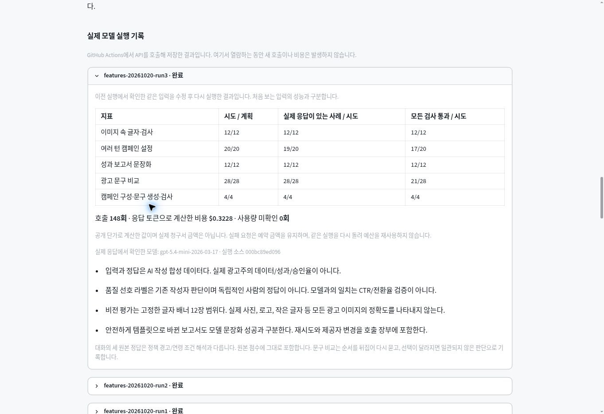
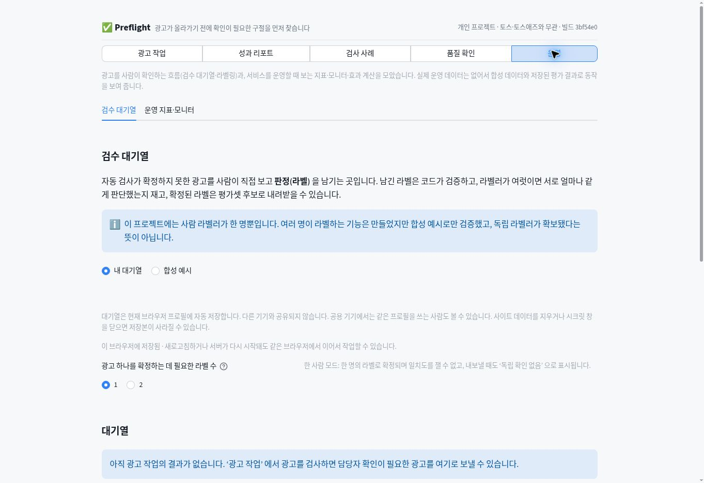

# 공개 배포 확인 — 2026-10-21 UTC

기능·문서·런타임 변경을 [PR #2](https://github.com/sokldjs554/toss-ads-ai-project/pull/2)로 main에 병합한 뒤, **실제 GitHub Pages 공개 주소**에서 확인했다. 아래 화면의 배포 커밋은 `3bf54e0eeae0f53fc18cf773e82aaa2d96928ba0`이다. 이 증거를 추가하는 후속 커밋은 제품 코드를 변경하지 않는다.

- [공개 첫 화면](https://sokldjs554.github.io/toss-ads-ai-project/)
- [직접 확인한 실제 API 기록 화면](https://sokldjs554.github.io/toss-ads-ai-project/app/?view=%ED%92%88%EC%A7%88%20%ED%99%95%EC%9D%B8#13b99140)
- [병합 커밋 CI](https://github.com/sokldjs554/toss-ads-ai-project/actions/runs/39532409833): 성공, **3,995개 통과·282.84초**. 회귀 게이트와 앱 실행 검사도 완료했다. 완료 시각 02:26:25 UTC.
- [Pages 배포](https://github.com/sokldjs554/toss-ads-ai-project/actions/runs/39532409843): 빌드·배포 성공, 완료 시각 02:20:37 UTC.

## 공개 브라우저에서 확인한 흐름

Chrome 클라우드 브라우저의 1363×936 화면을 직접 조작했다. [관측 영수증](browser-receipt.json)과 DOM 원문·화면을 남겼다. 별도 로컬 검사의 122개·36개·60회와 합쳐 하나의 공개 전체 검사 수로 소개하지 않는다.

| 흐름 | 직접 관측한 결과 | 근거 |
|---|---|---|
| 첫 화면 → 실제 API 기록 | 새 카드가 나타나고 품질 확인으로 연결됨 | [첫 화면](landing.jpg) |
| 최신 기록 | run3가 기본으로 펼쳐짐. 이미지 12/12, 대화 17/20, 성과 보고서 12/12, 문구 비교 21/28, 생성 흐름 4/4. 148회·$0.3228·실제 모델·평가 소스가 원본과 일치 | [화면](live-records.jpg), [DOM](quality-dom.txt) |
| 광고 작업 → 예시로 바로 실행 | 가상 신용대출 광고안 3개, 점검 통과 2개·게재 불가 1개, 수정안 확인 완료. 처리 기록 `tr_7f48f7609bc7`. 예시 실행·실제 호출 없음·$0.0000 표시 | [화면](sample-result.jpg), [DOM](sample-dom.txt) |
| 운영 → 설정 저장 → 전체 새로고침 | 처음 빈 대기열에서 필요한 라벨 수를 2→1로 변경. 저장 완료 뒤 페이지를 새로고침하고 운영 화면으로 돌아왔을 때 1로 복원됨. 검사 뒤 원래 값 2로 되돌림 | [복원 화면](settings-restored.jpg), [DOM](settings-restored-dom.txt) |

공개 검사는 **설정 한 항목의 복원**을 확인했다. 광고 항목·담당자·라벨의 복원, 동시 쓰기·실패 처리는 [별도 저장 검사](../final-2026-10-21/stlite-upgrade/storage-compatibility/README.md)의 범위다. 공개 대기열에 시험용 광고를 넣거나 기존 데이터를 삭제하지 않았다. 앱 화면 전환은 처음 진입한 URL 쿼리를 바꾸지 않으므로 예시·운영 화면의 주소에도 `view=품질 확인`이 남아 있다.

### 실제 공개 기록 화면

### 새로고침 뒤 설정 복원

## 공개 파일 대조

독립적인 HTTP 확인은 [상세 기록](http/README.md), [원본 JSON](http/receipt.json)에 있다. 인증서와 호스트명을 확인하는 정상 TLS로 랜딩·앱 HTML·앱이 참조하는 ZIP을 받았으며 세 요청 모두 200이었다.

- 앱 HTML의 JS·CSS는 모두 stlite **1.12.0**이다.
- 공개 ZIP의 빌드 표시는 **3bf54e0**이다.
- run3 원본 SHA-256은 `3981f9ab9a82502f02a8e6086e4178289863c8a632317dbb5544710af828fd91`로 일치한다.
- 고정 소스 79개 중 ZIP에 들어가는 **77/77개**, 고정 입력 18개 중 **6/6개**의 해시가 일치한다. 포함되지 않은 워크플로·실행 예약 스크립트 2개와 평가 PNG 12개는 이 집계에서 제외했다.

모델 평가 소스 `000bc89`와 공개 배포 소스 `3bf54e0`은 다르다. 모델 경로의 고정 소스와 원본 보고서를 대조한 결과이며, 공개 화면을 열어 새 모델 평가를 실행한 것은 아니다. 이 확인은 Render 서버 배포, 장시간 운영, 모든 브라우저, 실제 광고 성과, 독립 사람 평가를 입증하지 않는다.
